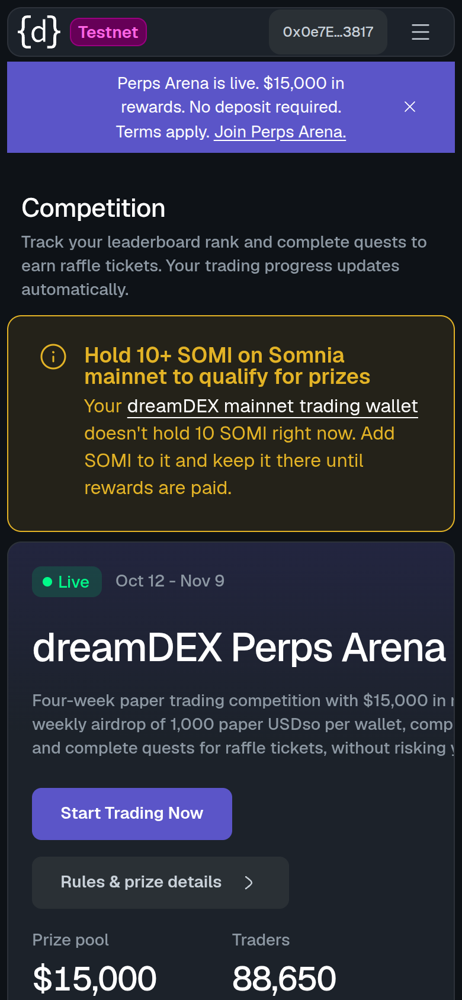

<p align="center">
  
</p>

<p align="center">
  
  
  
  
  
</p>

Thirty-four issue reports for the **dreamDEX Perps Builder Bounty (Feedback track)**, found on **Somnia Tokyo testnet** (chain id
50383; the docs and the SDK call it "Hideki"), plus the testnet app, SDK docs, REST API and WebSocket feeds: 5 major and 29 normal. Each one is a single Markdown file in [`feedback/`](feedback)
that follows the bounty template (Severity, Area, Steps to reproduce, Expected, Actual, Evidence, Environment) and opens
with a two-line summary. Each also has a one-command reproduction or exact manual steps, plus saved output in
[`evidence/`](evidence).

**Re-verified 2026-10-25, 22:37–23:04 UTC**, against SDK 0.32.1 (still npm `latest`), the current docs (app.dreamdex.io/docs)
and the live testnet: all ten reports filed by then still reproduce, and #04 is worse (13 of 13 busy accounts now fail). #08 was re-run with a
brand-new account, and #09 with a fresh transaction. Each report has a dated "Re-verified 2026-10-25" note under its summary
([re-check log](evidence/recheck_2026-10-25T2239Z.txt)). Two earlier reports are [archived](#archived): 07 was withdrawn on
2026-10-20, and 11 no longer reproduces as filed, because the explorer now points users to the right network.

**Reports 13–27 were added on 2026-10-26** ([first reported 05:30 UTC](https://github.com/swiftbotlab/dreamdex-feedback/commit/326d56c)). Each was reproduced against the live
testnets, the current docs and SDK 0.32.1 between 00:53 and 04:57 UTC that day, and has a dated "Checked 2026-10-26"
note under its summary. Their scripts and saved outputs are in `evidence/<number>/` (for example [`evidence/13/`](evidence/13/)).

**Reports 28–36 were added later on 2026-10-26** ([first reported 08:35 UTC](https://github.com/swiftbotlab/dreamdex-feedback/commit/bc9147e)). Each was reproduced
read-only (pinned `eth_call`s, receipts, indexer, REST and app reads) against the live testnets, the current docs and SDK 0.32.1
between 06:08 and 08:27 UTC that day, and has a dated "Checked 2026-10-26" note under its summary. Their scripts and saved
outputs are in `evidence/<number>/` too (for example [`evidence/28/`](evidence/28/)).

**Severity** (the bounty's scale: critical | major | normal): 
 · Jump to: [Major](#major) ·
[Normal](#normal) · [Archived](#archived) · [Fix checklist](#fix-checklist) · [Index](#index) · [Quick start](#quick-start)

## Major

These five stop or mislead users and developers in a core flow today.

### #10 · Every perps route redirects to the STT-USDso spot market
 &nbsp;`app`

**Impact:** nobody can open the perps trading view in the app while the Perps Arena is running. The nav, the logo, the
Arena's **Start trading** / **Start Trading Now** buttons and the market selector's perp rows all end on STT-USDso spot,
whether the user is logged in or not, from 38 check-host nodes in 25 countries (2026-10-20). On 2026-10-20 the app's own
flags said perps were on (`gate-perps: false`, `perps-default-landing: true`).


**Repro:** `curl -sI https://app.testnet.dreamdex.io/trade/perps/tokyo/BTC-PERP | grep -i location` → `location: /trade/spot/tokyo/STT:USDso`<br>
[Report](feedback/10-app-every-perps-route-redirects-to-the-stt-spot-market.md) ·
[Evidence](evidence/perps_redirect_2026-10-25T2245Z.txt) · First reported
[2026-10-19 19:42 UTC](https://github.com/swiftbotlab/dreamdex-feedback/commit/f5cef3d) · Re-checked 2026-10-25 22:45–22:48 UTC:
still `307` to STT-USDso spot, logged out and logged in; the Arena's **Start trading** lands on spot
([screenshot](evidence/perps-redirect-start-trading-2026-10-25.png))

### #01 · The developer page's only paper-USDso route, `claimPerpVoucher`, reverts with `SelfClaimDisabled()`
 &nbsp;`docs`

**Impact:** "Get test funds" on the developer page offers one route to paper USDso, `claimPerpVoucher`, and it fails for
every caller: `claim()` reverts with `0x3e31dcc2` before any of the documented checks. (The trading page does say paper
USDso comes from the Perps Arena; the developer page does not.)

**Repro:** `node scripts/claim_from.mjs 0x000000000000000000000000000000000000dEaD` → `REVERT 0x3e31dcc2`<br>
[Report](feedback/01-paper-usdso-self-claim-disabled-on-chain.md) · [Evidence](evidence/recheck_2026-10-25T2239Z.txt) ·
First reported [2026-10-19 09:41 UTC](https://github.com/swiftbotlab/dreamdex-feedback/commit/66e8188) · Re-checked
2026-10-25 22:39 UTC: same revert for four callers, and the docs still show the `claimPerpVoucher` sample

### #04 · Indexer `MarginEvents` query used by the SDK fails for every busy account we tested
 &nbsp;`API`

**Impact:** `getMarginEvents(account, { kinds })`, the read behind the documented portfolio-return recipe, fails every
time after about 10.5 s with a generic `database query error` for all 13 busy accounts we tested on 2026-10-25 (6 of 13
on 2026-10-20; all have more than 100k rows), the market makers and bots it is meant for. Quiet accounts are not affected.

**Repro:** `bash scripts/indexer_accounts.sh 0x47537e3a3ea6e9391f3b26ea45618db6828c8bff` → `SDK shape: 10.5s ERROR`<br>
[Report](feedback/04-indexer-margin-events-query-times-out.md) ·
[Evidence](evidence/indexer_accounts_2026-10-25T2240Z.txt) · First reported
[2026-10-19 09:41 UTC](https://github.com/swiftbotlab/dreamdex-feedback/commit/66e8188) · Re-checked 2026-10-25 22:40–23:04 UTC:
13 of 13 busy accounts fail (6 of 13 on 2026-10-20)

### #13 · The Builder's run command for perps bots (`npm run dev`, i.e. `tsx watch`) turns one Ctrl-C into two, so the bots skip their shutdown cleanup
 &nbsp;`SDK`

**Impact:** for every perps strategy the dreamBot Builder prints `npm run dev -w <perp workspace>`. Under `tsx watch` one Ctrl-C reaches the bot as two SIGINTs about 3 ms apart; the kit's `onStop()` takes the second as "press again to exit now" and calls `process.exit(1)`. In a live run on Tokyo, perp-maker left both quotes on the book at full size until we cancelled them by hand. The same Ctrl-C under `npm start` pulls both quotes, as the README promises.

**Repro:** dry run, no key: in the kit (`2579866`) run `npm run dev -w perp-maker` with `NETWORK=hideki DRY_RUN=true`, press Ctrl-C once → exit without the cleanup lines; `npm start -w perp-maker` → quotes cancelled<br>
[Report](feedback/13-bot-kit-npm-run-dev-ctrl-c-skips-perp-bot-shutdown-cleanup.md) · [Evidence](evidence/13/) · First reported [2026-10-26 05:30 UTC](https://github.com/swiftbotlab/dreamdex-feedback/commit/326d56c) · Checked 2026-10-26 01:35–03:53 UTC (live run, fresh-clone pty runs, Builder chunk and kit `HEAD` unchanged)

### #28 · A perp TP/SL closes only part of its size, or nothing, when the owner has a resting order on the closing side
 &nbsp;`contracts`

**Impact:** when a reduce-only TP/SL fires, the PerpStopOrderRegistry sizes it by `getReducingCapacity(owner).effectiveReducingCapacity` (the position minus every order the owner rests on the closing side, even limits far from the market), not by `min(quantity, |position|)`. The stop then closes only the rest and is reported `success`, or places nothing and is reported `ReduceOnlyBelowMinQty` at 1.05× to 3,240× the pool minimum. Either way it is used up, and no docs page or SDK doc mentions it. All 25 `ReduceOnlyBelowMinQty` drops on record are this case.

**Repro:** `node evidence/28/stop_case.mjs 0x43dbc0706b992846233f66661cb93b116e70ca9c515ca270a0ea3e7468903f02 184467440737095517909` (read-only) → a 4,617.7 NEAR stop-loss placed `2183.6`, `placed == capacity: true`<br>
[Report](feedback/28-contracts-perp-tpsl-is-cut-to-reducing-capacity-by-resting-orders-on-the-closing-side.md) · [Evidence](evidence/28/) · First reported [2026-10-26 08:35 UTC](https://github.com/swiftbotlab/dreamdex-feedback/commit/bc9147e) · Checked 2026-10-26 07:52–08:12 UTC: 7 cases rebuilt; 5 pending stops on 2 accounts would fire short at block 33,501,406

## Normal

### #02 · SDK says `eligible: true` while `claim()` reverts, and the error is missing from `contractErrorsAbi`
 &nbsp;`SDK`

**Impact:** two SDK defects, separate from #01's docs fix: `getPerpVoucherEligibility` says it mirrors `claim()` but skips
the distributor's first gate, and the SDK cannot decode the revert that gate produces.

**Repro:** `node scripts/voucher_check.mjs` → all six eligibility reads pass, then `"data":"0x3e31dcc2"`<br>
[Report](feedback/02-sdk-voucher-eligibility-ignores-self-claim-disabled.md) ·
[Evidence](evidence/recheck_2026-10-25T2239Z.txt) · First reported
[2026-10-19 09:41 UTC](https://github.com/swiftbotlab/dreamdex-feedback/commit/66e8188) · Re-checked 2026-10-25 22:39 UTC
(0.32.1 is still npm `latest`; the 0.32.2 canary has the same gap)

### #03 · Docs block six markets for paper USDso; the chain allows all 21
 &nbsp;`docs`

**Impact:** a bot that trusts the docs' market table refuses six markets that a paper-USDso account can trade.
`isVoucherMarketAllowed` is `true` for all 21 pools, and a paper-USDso-only account's resting bid is accepted on ZEC-PERP
and PUMP-PERP (both "No" in the docs).

**Repro:** `node scripts/survey.mjs > survey.json` → `voucherAllowed: true` for every pool<br>
[Report](feedback/03-paper-usdso-market-allowlist-docs-vs-chain.md) ·
[Evidence](evidence/voucher_only_orders_2026-10-25T2240Z.txt) · First reported
[2026-10-19 09:41 UTC](https://github.com/swiftbotlab/dreamdex-feedback/commit/66e8188) · Re-checked 2026-10-25 22:40 UTC:
chain 21/21, voucher-only bids accepted on ZEC and PUMP (no-collateral control reverts), docs table unchanged

### #05 · Perps guide's trading-gain recipe throws, and its block window is silently ignored
 &nbsp;`docs`

**Impact:** the documented recipe throws on kind `CreditReclaimed`. Without that kind, `getMarginEvents` 0.32.1 ignores
`sinceBlock` / `toBlock`, so the recipe also counts deposits made before the window, with no error.

**Repro:** `npm pack @somnia-chain/markets-sdk@0.32.1 && tar xzf somnia-chain-markets-sdk-0.32.1.tgz && grep -c sinceBlock package/src/perp/history.ts` → `0`<br>
[Report](feedback/05-sdk-perps-guide-documents-getmarginevents-options-that-0.32.1-does-not-have.md) · Evidence: source
lines quoted in the report · First reported
[2026-10-19 09:41 UTC](https://github.com/swiftbotlab/dreamdex-feedback/commit/66e8188) · Re-checked 2026-10-25 22:39–22:44 UTC
(0.32.1 and the canary unchanged; recipe still in the SDK docs)

### #12 · Indexer `MarginEvent` rows have no block number
 &nbsp;`API`

**Impact:** fills, orders and liquidations carry a block, margin events only a seconds `timestamp`. With about 10 Hideki
blocks per second, the SDK docs' block-windowed flow read (blocks `a + 1` to `b`) cannot be done from the indexer. This is
the indexer half of #05, with its own fix (a column).

**Repro:** `bash scripts/margin_event_fields.sh` → `field 'blockNumber' not found in type: 'MarginEvent'`<br>
[Report](feedback/12-indexer-margin-events-have-no-block-number.md) ·
[Evidence](evidence/margin_event_fields_2026-10-25T2244Z.txt) · First reported
[2026-10-20 03:44 UTC](https://github.com/swiftbotlab/dreamdex-feedback/commit/efb7bb4) · Re-checked 2026-10-25 22:44 UTC

### #06 · The Errors page lacks the perp errors
 &nbsp;`docs`

**Impact:** the developer page sends readers to an Errors page that lists none of the perp, MarginBank or voucher errors,
including ones the developer page itself names (`InsufficientCollateral`, `MaxPositionSizeExceeded`).

**Repro:** open `/docs/developers/contracts/errors` and search for `InsufficientCollateral` or `Voucher` → no match<br>
[Report](feedback/06-errors-page-lacks-perp-errors-and-wrong-scale-message-differs.md) · First reported
[2026-10-19 09:41 UTC](https://github.com/swiftbotlab/dreamdex-feedback/commit/66e8188) · Re-checked 2026-10-25 22:37 UTC ·
Corrected 2026-10-20 (wrong-scale half removed)

### #08 · Link a bot, the docs' "simplest route" to bot gas, is blocked for a new account and names no STT source
 &nbsp;`app`

**Impact:** a new account sees "Can't add a bot yet … has no STT", and neither that message nor the perps docs pages name
an STT source. The faucets other docs pages name pay on Shannon, and the app moves that STT to Tokyo silently, only once
the app is reopened.


**Repro:** manual (app UI; report steps 1–3 with a new e-mail login)<br>
[Report](feedback/08-app-link-a-bot-blocked-for-new-accounts-no-stt-source.md) ·
[Evidence](evidence/link_a_bot_new_account_2026-10-25T2254Z.txt) · First reported
[2026-10-19 10:58 UTC](https://github.com/swiftbotlab/dreamdex-feedback/commit/f2a1e30), corrected 2026-10-19 15:20 UTC and
2026-10-20 · Re-checked 2026-10-25 22:52–22:55 UTC with a brand-new account
([screenshot](evidence/link-a-bot-new-account-2026-10-25.png))

### #09 · Documented perp gas cost is the discounted price; a new bot pays about 10×
 &nbsp;`docs`

**Impact:** the page's 0.0003–0.003 STT is what heavy senders pay after Somnia's 70–90 % sustained-use discount. A new bot
key pays the full 6 gwei: one minimal resting order costs 0.0141 STT, 4.7× the documented maximum.

**Repro:** `node scripts/perp_gas_sample.mjs 0xD6Cb1DD58580B84D76068aC21594219ce03aeddf 0x4181dd08E73BbCdd1Ba3E615A18f6abD941b94C0 0xB483ec1fb34996638677c20ab087b16F1896FA53` (read-only; `fee_floor_test.mjs` sends transactions)<br>
[Report](feedback/09-docs-perp-gas-cost-range-is-10x-below-what-a-new-sender-pays.md) ·
[Evidence](evidence/fee_floor_test_2026-10-25T2250Z.txt) · First reported
[2026-10-19 15:23 UTC](https://github.com/swiftbotlab/dreamdex-feedback/commit/b69748b) · Re-checked 2026-10-25 22:50 UTC:
fresh 6 gwei transaction `0x024923cb…1ce9`; 0.6 gwei still rejected; docs figure unchanged

### #14 · A perp amend that changes side reverts with `0x44a03a20` since the 2026-10-21 upgrade; the SDK cannot decode it and the docs never mention it
 &nbsp;`SDK`

**Impact:** since the PerpPool upgrade at block 29,293,077, `amendOrder` / `amendOrders` with the other side reverts with `0x44a03a20` on all 21 pools. The selector is not in the SDK's `contractErrorsAbi` (0.32.1 or canary), so `errorName` is `undefined`, and no docs page states the rule or lists the error.

**Repro:** `curl -s -H 'content-type: application/json' --data @evidence/14/req_flip_to_ask.json https://api.hideki2.infra.testnet.somnia.network` → revert `0x44a03a20…`; `req_same_side_control.json` → success<br>
[Report](feedback/14-sdk-perp-amend-side-change-reverts-0x44a03a20-undecoded-and-undocumented.md) · [Evidence](evidence/14/) · First reported [2026-10-26 05:30 UTC](https://github.com/swiftbotlab/dreamdex-feedback/commit/326d56c) · Checked 2026-10-26 03:33–03:41 and 04:50–04:57 UTC: 8 of 8 side changes revert, 4 of 4 same-side controls pass

### #15 · Indexer: `listPerpOrderHistory` fails after ~10.5 s for high-volume accounts that stopped trading
 &nbsp;`API`

**Impact:** the Perps guide's read for finished orders fails with `database query error` after about 10.5 s for 7 of 7 high-volume accounts that have stopped trading. The same filter sorted by `placedAtTimestamp` answers in 0.2–2.1 s. Separate from #04 (different entity, different index).

**Repro:** `curl -s -H 'content-type: application/json' https://hideki-dev.smk.somnia.host/v1/graphql --data @evidence/15/sdk_body_ended_0x3024.json` → `database query error` after ~10.5 s; `sdk_body_placed_0x3024.json` → 100 rows<br>
[Report](feedback/15-indexer-list-perp-order-history-fails-for-idle-high-volume-accounts.md) · [Evidence](evidence/15/) · First reported [2026-10-26 05:30 UTC](https://github.com/swiftbotlab/dreamdex-feedback/commit/326d56c) · Checked 2026-10-26 00:53–03:33 UTC (6 passes) and 04:48 UTC

### #16 · SDK docs give perp leverage in bps of 1× (10,000 = 1×), but the SDK and the chain use whole multipliers
 &nbsp;`docs`

**Impact:** the "Units and scales" page lists `setPerpLeverage` / `getPerpMaxLeverage` as "10,000 = 1.00×, 200,000 = 20×". The SDK types and the MarginBank take a whole multiplier (`10` = 10×, uint16, limit `20`), so the table's own values revert `InvalidLeverage()` (10,000) or cannot be encoded (200,000).

**Repro:** `cast call --from 0x2A11e7388D1D2F9690f2636846d44b478f61bF08 0x478769E1177C0773c43A593DCCc4Ad15F15F1394 'setMaxLeverage(address,uint16)' 0x4181dd08E73BbCdd1Ba3E615A18f6abD941b94C0 10000 --rpc-url https://api.hideki2.infra.testnet.somnia.network` → `InvalidLeverage`; `20` → ok<br>
[Report](feedback/16-sdk-docs-perp-leverage-documented-in-bps-but-is-a-whole-multiplier.md) · [Evidence](evidence/16/) · First reported [2026-10-26 05:30 UTC](https://github.com/swiftbotlab/dreamdex-feedback/commit/326d56c) · Checked 2026-10-26 03:20–03:22 UTC (0.32.1 and canary, both hosted copies) and 04:51 UTC

### #17 · SDK `listPerpOrderRejections` returns amend rejections as if they were batch-placement refusals
 &nbsp;`SDK`

**Impact:** the indexer marks `amendOrders` refusals with `isAmend = true` and an `oldOrderId`. SDK 0.32.1 selects neither column, so amend rows come back as "orders refused inside a batch placement", which its TSDoc says is all the read holds. For an owner who re-quotes with `amendOrders`, every row returned is an amend row.

**Repro:** `bash evidence/17/order_rejections_curl.sh` → the SDK's query returns the rows; the same rows have `isAmend: true`<br>
[Report](feedback/17-sdk-list-perp-order-rejections-returns-amend-rejections-as-placements.md) · [Evidence](evidence/17/) · First reported [2026-10-26 05:30 UTC](https://github.com/swiftbotlab/dreamdex-feedback/commit/326d56c) · Checked 2026-10-26 01:24–03:29 UTC and 04:48 UTC

### #18 · SDK `getOpenInterestHistory` paging repeats some rows and never returns others
 &nbsp;`SDK`

**Impact:** the read is documented as "newest first — paginated" but sorts by `timestamp` only. Snapshots from one block tie, and the indexer orders ties differently per page: paging PUMP's history in default pages of 100 returned 2,992 rows but only 2,990 distinct. Two came back twice, two never, one of them the block's final open interest.

**Repro:** `node evidence/18/oi-paging_check.mjs 0x76c981a52530cdf9497559140aafcd8cd16836e7 walk` → repeated and missing ids<br>
[Report](feedback/18-sdk-open-interest-history-paging-repeats-and-skips-rows.md) · [Evidence](evidence/18/) · First reported [2026-10-26 05:30 UTC](https://github.com/swiftbotlab/dreamdex-feedback/commit/326d56c) · Checked 2026-10-26 01:26–03:35 UTC and 04:49 UTC

### #19 · The Markets page shows the Global region (Shannon), not DreamDEX, where testnet perps run
 &nbsp;`app`

**Impact:** every row on `/explore` comes from the Global region (indexer `dev.smk.somnia.host`, chain 50312). The perps card says "15 MARKETS" with Shannon prices and ranking; six of the 21 documented markets (ZEC, LIT, VVV, 1000PEPE, PUMP, ZRO) never appear. The spot card's STT row shows Global SOMI's 24h volume, about 21× DreamDEX STT's.

**Repro:** open `https://app.testnet.dreamdex.io/explore` and compare with `Market` on `dev.smk.somnia.host` and `hideki-dev.smk.somnia.host` (report step 2) → the page matches the Shannon indexer<br>
[Report](feedback/19-app-markets-page-shows-the-shannon-region-not-dreamdex.md) · [Evidence](evidence/19/) · First reported [2026-10-26 05:30 UTC](https://github.com/swiftbotlab/dreamdex-feedback/commit/326d56c) · Checked 2026-10-26 02:16–02:30 and 03:37–03:47 UTC, logged in and logged out

### #20 · The public trader page's Wallet section shows the Shannon balance instead of Tokyo
 &nbsp;`app`

**Impact:** `/trader/<address>` → Balances reads the wallet from `/api/trader/<address>/assets`, which returns the Shannon (50312) balance. A Perps Arena trader holding 15 STT on Tokyo is shown "Nothing held in the wallet itself"; our wallet (42.96 STT on Tokyo) shows "STT 0.65".

**Repro:** `curl -s https://app.testnet.dreamdex.io/api/trader/0x2d1242b88f6979d93bae5968ec292fae640932d4/assets` → no STT; `eth_getBalance` on the Hideki RPC → 15 STT<br>
[Report](feedback/20-app-trader-page-wallet-shows-shannon-balance-not-tokyo.md) · [Evidence](evidence/20/) · First reported [2026-10-26 05:30 UTC](https://github.com/swiftbotlab/dreamdex-feedback/commit/326d56c) · Checked 2026-10-26 02:33–02:41 and 03:44–03:46 UTC; route and balances again 04:51 UTC

### #21 · For e-mail logins, deposit/withdrawal history and Activity always fail to load, because the app never requests them
 &nbsp;`app`

**Impact:** signed in with e-mail (Privy embedded wallet), Portfolio → Deposits & withdrawals always says "Failed to load deposits and withdrawals." and the wallet panel's Activity says "Try again in a moment". No request is ever sent; the same session's `/api/transfers` call returns the account's movements.

**Repro:** manual: e-mail login → Portfolio → Deposits & withdrawals → "Failed to load…"; DevTools shows no `/api/transfers` request<br>
[Report](feedback/21-app-email-login-deposit-withdrawal-and-activity-history-always-fail-to-load.md) · [Evidence](evidence/21/) · First reported [2026-10-26 05:30 UTC](https://github.com/swiftbotlab/dreamdex-feedback/commit/326d56c) · Checked 2026-10-26 02:18–02:29 and 03:39–03:44 UTC

### #22 · The dreamBot Builder's Download saves the config as `env.txt`, which the kit never reads and `.gitignore` does not cover
 &nbsp;`app`

**Impact:** in Chrome the Builder's "Your config (.env)" Download is saved as `env.txt`. The kit loads only `.env`, so the key and every Tune value are dropped without a warning (`perp:doctor`: "no PRIVATE_KEY — market view only"), and `git add .` stages the file that holds the bot's private key.

**Repro:** Builder → Get my bot → Download → `env.txt`; in the kit `npm run perp:doctor` → `(no PRIVATE_KEY — market view only)`; `git check-ignore -v env.txt` → not ignored<br>
[Report](feedback/22-app-dreambot-builder-download-saves-env-txt-which-the-kit-never-reads.md) · [Evidence](evidence/22/) · First reported [2026-10-26 05:30 UTC](https://github.com/swiftbotlab/dreamdex-feedback/commit/326d56c) · Checked 2026-10-26 03:11–03:17 UTC and 03:49 UTC (bundle unchanged)

### #23 · The SDK's hosted reference still documents 0.31.0: `SOMNIA_HIDEKI_TESTNET_ADDRESSES` is a 404
 &nbsp;`docs`

**Impact:** npm `latest` 0.32.1 sends readers to prd.smk.somnia.host/docs/typescript, which still matches 0.31.0. The address constant the perps developer page uses is a 404, and the voucher and account-equity methods it and the Perps guide use are missing.

**Repro:** `curl -s -o /dev/null -w '%{http_code}\n' https://prd.smk.somnia.host/docs/typescript/api/index/variables/SOMNIA_HIDEKI_TESTNET_ADDRESSES` → `404`<br>
[Report](feedback/23-sdk-docs-hosted-reference-still-documents-0.31.0.md) · [Evidence](evidence/23/) · First reported [2026-10-26 05:30 UTC](https://github.com/swiftbotlab/dreamdex-feedback/commit/326d56c) · Checked 2026-10-26 03:27 UTC and 04:51 UTC

### #24 · SDK reactivity methods throw, although the docs promise `T | Error` and a silent `null` without a wallet
 &nbsp;`SDK`

**Impact:** `getSubscriptionInfo` rejects for an id that does not exist (a `return` without `await` inside `try`). Without a wallet, `subscribe` and `scheduleSubscriptionAt*` reject and `unsubscribe` resolves to an Error; none resolves to `null`. Code written to the docs' `instanceof Error` idiom crashes.

**Repro:** `await createReactivity(ex.client).getSubscriptionInfo(10n ** 30n)` → rejects with `ContractFunctionExecutionError` (report step 2)<br>
[Report](feedback/24-sdk-reactivity-methods-throw-despite-documented-t-or-error-contract.md) · [Evidence](evidence/24/) · First reported [2026-10-26 05:30 UTC](https://github.com/swiftbotlab/dreamdex-feedback/commit/326d56c) · Checked 2026-10-26 04:31–04:35 UTC

### #25 · WebSocket: the `trades` snapshot sends `null`, is oldest-first and holds only the last 1–3 minutes
 &nbsp;`API`

**Impact:** on the documented testnet feed `wss://stg.api.dreamdex.io/v0/ws/public`, the snapshot clients rebuild from after a reconnect sends `"trades": null` for small limits, is oldest-first, and holds 7–20 trades for `limit` 100 or 500, while REST returns 100 rows covering ~17 minutes.

**Repro:** subscribe `{"operation":"subscribe","channel":"trades","params":{"symbols":["SOMI:USDso"],"limit":1}}` → `"trades":null`<br>
[Report](feedback/25-websocket-trades-snapshot-null-oldest-first-and-only-minutes-deep.md) · [Evidence](evidence/25/) · First reported [2026-10-26 05:30 UTC](https://github.com/swiftbotlab/dreamdex-feedback/commit/326d56c) · Checked 2026-10-26 03:10–04:38 UTC (stg and api.testnet)

### #26 · Docs: the WebSocket `order` channel sends no `order:snapshot` and no `order.status`
 &nbsp;`docs`

**Impact:** the docs' tracking flow waits for an `order:snapshot` and a terminal `order.status`. Both testnet hosts send flat `event` frames (`placed`, `rested`, `filled`, `cancelled`) with no snapshot, no `order` object and no `status`, and replay only recent events, so an older open order gets no frame at all.

**Repro:** `node evidence/26/vr_order.mjs wss://stg.api.dreamdex.io/v0/ws/public 20 fresh` → `SUMMARY` with 0 snapshot frames and 0 frames with `order` or `status`<br>
[Report](feedback/26-docs-websocket-order-channel-sends-no-snapshot-and-no-order-status.md) · [Evidence](evidence/26/) · First reported [2026-10-26 05:30 UTC](https://github.com/swiftbotlab/dreamdex-feedback/commit/326d56c) · Checked 2026-10-26 03:09–04:40 UTC on both hosts

### #27 · Docs: all three `order` subscribe examples are rejected by the testnet feed
 &nbsp;`docs`

**Impact:** the Real-Time Feed page and Quick Start give three `order` subscribe frames; the feed they name answers each with `subscription_failed`. Two leave out the required `symbol`, and all three pass a hex `orderId` where stg's spec wants a decimal string.

**Repro:** `node evidence/27/order_sub_verify.mjs` → examples A/B/C `subscription_failed`; `{symbol, orderId: "<decimal>"}` subscribes<br>
[Report](feedback/27-docs-websocket-order-subscribe-examples-are-rejected-by-the-feed.md) · [Evidence](evidence/27/) · First reported [2026-10-26 05:30 UTC](https://github.com/swiftbotlab/dreamdex-feedback/commit/326d56c) · Checked 2026-10-26 03:08–04:33 UTC on both hosts

### #29 · When one leg of a linked TP/SL pair fills only partly, the other leg is still cancelled and the rest of the position keeps no stop-loss
 &nbsp;`contracts`

**Impact:** a MARKET stop fires as an IOC at the mark ± 5 %, so on a thin book it can fill only part of its size. The registry still cancels the linked leg (`LinkedOrderCancelled`, `cancelReason` `LinkedFill`), exactly as after a full fill. On SOL-PERP a take-profit closed 1,044.81 of a 1,896.46 SOL short and the stop-loss was cancelled; the remaining 851.65 SOL short has had no stop-loss for more than 57 hours. `listPerpStopOrders` shows the same two rows as a full close.

**Repro:** `node evidence/29/fired_leg_case.mjs 0x7e128dfa20858595d8221c7b983e2894f900b42918fc5a977ea79ea6256cdff4 2102928824402888886116` (read-only) → `fillRatioPct 55.09`, partner `LinkedOrderCancelled`<br>
[Report](feedback/29-contracts-linked-tpsl-partial-fill-cancels-the-other-leg-and-leaves-no-stop-loss.md) · [Evidence](evidence/29/) · First reported [2026-10-26 08:35 UTC](https://github.com/swiftbotlab/dreamdex-feedback/commit/bc9147e) · Checked 2026-10-26 07:55–08:06 UTC (3 cases)

### #30 · SDK `previewPerpClosePnl` says a position below `minQuantity` cannot be closed, but one order of exactly its size closes it
 &nbsp;`SDK`

**Impact:** for a position smaller than the market's `minQuantity`, `previewPerpClosePnl` returns `placeable: false`, and its TSDoc says the position "can only leave via liquidation or ADL"; the docs say anything below the minimum "is rejected automatically". The PerpPool accepts a closing order of exactly the position size (15 of 15 on BTC, ETH and WLD); every other size below the minimum reverts `QuantityBelowMinimum`. 63 of 10,856 open positions were below their minimum at 08:08 UTC.

**Repro:** `curl -s -H 'content-type: application/json' --data @evidence/30/req_full_close_sell_2000.json https://api.hideki2.infra.testnet.somnia.network` → `result`; `req_partial_sell_1000.json` → revert `0xeaa68ceb` (`QuantityBelowMinimum`)<br>
[Report](feedback/30-sdk-preview-perp-close-pnl-says-a-dust-position-cannot-be-closed-but-an-exact-close-works.md) · [Evidence](evidence/30/) · First reported [2026-10-26 08:35 UTC](https://github.com/swiftbotlab/dreamdex-feedback/commit/bc9147e) · Checked 2026-10-26 08:06–08:12 UTC at the chain head and at pinned block 33,461,989

### #31 · REST API: funding fields are not "1e18-scaled fractions, exactly as the contract emits them", as the OpenAPI spec says
 &nbsp;`API`

**Impact:** on `api.testnet.dreamdex.io`, `GET /v0/markets/{symbol}/funding` and the `perp` block of `GET /v0/markets` return `fundingRate` as the contract value ÷ 1e18 (`"0.0001"` for `1e14`, all 24 perp markets). `cumulativeFundingPerUnit` is also ÷ 1e18, which leaves it in quote wei per whole base, unlike the USDso prices next to it. The indexer and the SDK return the raw contract value under the same names.

**Repro:** `curl -s 'https://api.testnet.dreamdex.io/v0/markets/ADA:USDso/funding?kind=perp&limit=2'` → `"fundingRate":"0.0001"`; `cast call 0x440f5a79857cd632ae45439410969c3f4049cc41 'getCurrentFundingRate()(int256)' --rpc-url https://dream-rpc.somnia.network` → `100000000000000`<br>
[Report](feedback/31-api-rest-funding-fields-are-not-1e18-scaled-as-the-openapi-spec-says.md) · [Evidence](evidence/31/) · First reported [2026-10-26 08:35 UTC](https://github.com/swiftbotlab/dreamdex-feedback/commit/bc9147e) · Checked 2026-10-26 07:31–07:40 UTC (this host serves Shannon, chain 50312)

### #32 · Indexer: the `PerpPosition.entryFundingIndex` description gives every short the wrong funding sign and leaves out the scale
 &nbsp;`API`

**Impact:** the GraphQL description says unsettled funding is "(getProjectedCumulativeFundingPerUnit() - entryFundingIndex) * size", but `size` is unsigned, so a short that receives funding comes out as paying and vice versa. It also leaves out the ÷ (1e18 × `oneBase`) the MarginBank applies. The data itself is right: 12 of 12 rows match `MarginBank.getPosition`.

**Repro:** `node evidence/32/entryidx_recipe_check.mjs 0xd6cb1dd58580b84d76068ac21594219ce03aeddf 3` → description ÷ chain formula ≈ +1e36 for longs, ≈ −1e36 for shorts<br>
[Report](feedback/32-indexer-entry-funding-index-recipe-gives-shorts-the-wrong-sign-and-omits-the-scale.md) · [Evidence](evidence/32/) · First reported [2026-10-26 08:35 UTC](https://github.com/swiftbotlab/dreamdex-feedback/commit/bc9147e) · Checked 2026-10-26 07:33–07:39 UTC

### #33 · The trading-account address links on Portfolio and the trader page open the explorer's Global view (chain 50312), not Tokyo
 &nbsp;`app`

**Impact:** the Trader card's "account: 0x…" link and the explorer link on `/trader/<address>` go to `explorer.testnet.somnia.network/address/<addr>`, the Global testnet view. It shows the account's Shannon balance and history (ours: 0.65 STT, 3 transactions) instead of Tokyo (42.957 STT, 12 transactions), with no Tokyo hint, unlike tx pages. Separate from #20 (an API route's balance) and archived #11 (tx links).

**Repro:** `curl -s https://app.testnet.dreamdex.io/trader/0x2d1242b88f6979d93bae5968ec292fae640932d4 | grep -o 'href="https://explorer[^"]*"'` → no `/tokyo`; that address is 0 STT / 1 tx in the Global view, 15 STT / 3 txs on `/tokyo`<br>
[Report](feedback/33-app-trading-account-address-links-open-the-global-explorer-view-not-tokyo.md) · [Evidence](evidence/33/) · First reported [2026-10-26 08:35 UTC](https://github.com/swiftbotlab/dreamdex-feedback/commit/bc9147e) · Checked 2026-10-26 in three passes, 06:30–07:57 UTC, logged in and logged out

### #34 · SDK: the `LiquidationEvent.size` TSDoc gives the sign of a liquidation backwards
 &nbsp;`SDK`

**Impact:** the TSDoc says a `PositionLiquidated` row's sign "is the side being closed". On chain `sizeDelta` is the change to the position, so a liquidated long has a negative `size` and a liquidated short a positive one (105 of 105 rows). `PositionTakenOver` / `PositionTransferred` rows in the same field carry the position's own sign. A builder who follows the TSDoc labels every liquidated long as a short.

**Repro:** `node evidence/34/check_rows.mjs 0x3d5d323c5a051b2ff6f822893483468e1ebf3b2dc8ceed0f6750c98f29b93247` → `size -24010000`, `position at block-1 24010000 (long)`<br>
[Report](feedback/34-sdk-liquidation-event-size-sign-is-documented-backwards.md) · [Evidence](evidence/34/) · First reported [2026-10-26 08:35 UTC](https://github.com/swiftbotlab/dreamdex-feedback/commit/bc9147e) · Checked 2026-10-26 06:08–07:21 UTC

### #35 · Trader page: the Balances tab's "Unrealized PnL" includes funding owed and does not match the Positions tab
 &nbsp;`app`

**Impact:** on `/trader/<address>`, Balances → PERPS MARGIN → UNREALIZED PNL is `equity − unlocked collateral`, so it also subtracts the funding the account owes. The Positions tab's PNL column is price only, as the SDK docs and the app's Portfolio define it. On `0x9ca8…210c` the tabs show −522.25 vs −468.85 USDso; the 53.40 gap is the account's accrued funding on chain. Neither tab shows funding.

**Repro:** `node evidence/35/pnl_gap_check.mjs 0x9ca8dc987deca9a3c94f6cf1b95eb12df5f6210c` (read-only) → `equity - unlockedCollateral` vs Σ price-only uPnL, gap = Σ `accruedFunding`; compare with both tabs of that trader page<br>
[Report](feedback/35-app-trader-page-balances-unrealized-pnl-includes-funding-and-differs-from-positions-tab.md) · [Evidence](evidence/35/) · First reported [2026-10-26 08:35 UTC](https://github.com/swiftbotlab/dreamdex-feedback/commit/bc9147e) · Checked 2026-10-26 in three passes, 06:56–08:12 UTC, on two accounts

### #36 · Phone: the Perps Arena hero card cuts its description off mid-word, and at 360–375 px its title too
 &nbsp;`app`

**Impact:** on `/competition-hub` (signed in) the description paragraph is `w-141 max-w-full`, a fixed 564 px inside an `overflow-clip` card. Below about 590 px every line is cut at the card edge ("…with $15,000 in r") and cannot be scrolled to, so "real rewards", "compete on weekly and season ROI" and "your own trading capital" are lost on every phone width (360–430 px). At 360 px the title reads "dreamDEX Perps Aren".



**Repro:** manual: sign in, Chrome device mode 390 × 844, open `/competition-hub` → description lines end "in r", "comp", "risking y"; console snippet in report step 5 → `['564px', 591, 384, 'clip', 390]`<br>
[Report](feedback/36-app-phone-perps-arena-hero-card-cuts-off-its-description-and-title.md) · [Evidence](evidence/36/) · First reported [2026-10-26 08:35 UTC](https://github.com/swiftbotlab/dreamdex-feedback/commit/bc9147e) · Checked 2026-10-26 in three runs, 06:09–07:40 UTC

## Archived

Kept for the record in [`archive/`](archive) and **not part of the submission**. Please do not count them.

- **#07**: [Indexer `Market.markPrice` lags the chain](archive/07-indexer-market-markprice-lags-chain-by-15-40-minutes.md).
  We withdrew it on 2026-10-20: SDK 0.32.1 documents that this field "advances only when funding settles — hourly on
  every live pool" (`PerpMarket.markPrice`, `src/markets.ts:191`), and every age we measured was under an hour.
- **#11**: [History tx links open the Shannon explorer](archive/11-app-trade-history-tx-links-open-the-shannon-explorer-which-cannot-find-hideki-txs.md).
  It changed after we filed it. By 2026-10-25 the links go to explorer.testnet.somnia.network, whose 50312 view says "This
  transaction is on Tokyo testnet. Open on Tokyo testnet", so they no longer dead-end
  ([evidence](evidence/trade_history_explorer_links_2026-10-25T2248Z.txt)).

## Fix checklist

One line per issue (area, where, expected behaviour), ready to paste into a tracker:

- [ ] **#10 app**: `/trade/perps/tokyo/<MARKET>-PERP` (Next.js middleware or `redirects()`) should serve the perps view, not a `307` to the STT-USDso spot market. If perps is off on purpose, show a notice and stop linking the Arena buttons to it.
- [ ] **#01 docs**: "Get test funds" on `/docs/developers/perps-testnet`: say that paper USDso is granted by the Perps Arena and caveat the `claimPerpVoucher` sample, or enable self-claim on `VoucherDistributor` `0x2ACD9EFdA721450906bfE1bef3edE269636E42C4`.
- [ ] **#04 indexer**: `MarginEvent` needs a composite index on `(account, kind, timestamp DESC, id)` (on 2026-10-25 ordering by id failed too). Return "statement timeout" instead of `database query error`.
- [ ] **#02 SDK**: `src/perp/voucher.ts` `getPerpVoucherEligibility`: add a `selfClaimDisabled` reason, checked first. Add `SelfClaimDisabled()` (`0x3e31dcc2`) to `src/contractErrorsAbi.ts`.
- [ ] **#03 docs**: the Paper USDso column on `/docs/trading/perps-testnet` and the margin-and-liquidations page: regenerate from `isVoucherMarketAllowed`, or fix the allowlist on chain.
- [ ] **#05 docs**: the scoring recipe on `/markets/somnia-markets/typescript/perps`: use only the options and kinds 0.32.1 has, or ship `sinceBlock`/`toBlock` and `CreditReclaimed` in the SDK.
- [ ] **#12 indexer**: add `blockNumber` and `logIndex` columns to `MarginEvent`, filterable and sortable, like `Fill` and `LiquidationEvent`.
- [ ] **#06 docs**: `/docs/developers/contracts/errors`: add a Perps table (MarginBank, PerpPool, VoucherDistributor, including `0x3e31dcc2`).
- [ ] **#08 app/docs**: the relayer should pay for the operator grant, or the Link a bot red message and "Get test funds" should name the STT source (faucet, pays on Shannon, the app moves it to Tokyo).
- [ ] **#09 docs**: the gas-cost sentence on `/docs/developers/perps-testnet` should quote costs at the undiscounted 6 gwei (about 0.01–0.015 STT per resting order) and mention the sustained-use discount. Resize "Send it 5 STT" to match.
- [ ] **#13 SDK (bot kit)**: print `npm start -w <workspace>` in the Builder's Option B and the four perp header comments (or make the perp `dev` scripts plain `tsx src/index.ts`); have `onStop()` ignore a repeat signal within ~1 s.
- [ ] **#14 SDK/docs**: add `0x44a03a20` (one `uint128` argument) to `contractErrorsAbi.ts` via `errors:gen`; state on the amend functions and `AmendOrderRequest` that `newOrder.isBid` must keep the resting side; add it to the Errors page.
- [ ] **#15 indexer**: index `Order (owner, lastUpdatedAtTimestamp DESC, id DESC)` for the SDK's default read; return "statement timeout" instead of `database query error`.
- [ ] **#16 docs**: "Units and scales": keep bps-of-1× only for `getPerpLeverage` fields; add a "leverage multiplier (`10` = 10×)" row for `setPerpLeverage`, `getPerpMaxLeverage` and the MarginBank leverage reads.
- [ ] **#17 SDK**: select `isAmend` and `oldOrderId` in `PerpOrderRejectionsQuery`, add an `isAmend` option, and fix the TSDoc that says amend rows cannot appear.
- [ ] **#18 SDK**: order `OpenInterestHistoryQuery` by `[{timestamp: desc}, {blockNumber: desc}, {id: desc}]`, as `LiquidationsQuery` does.
- [ ] **#19 app**: build `/explore` for the landing region (DreamDEX on testnet), not `GLOBAL_REGION`, and link rows to the region routes; or label the cards with their region.
- [ ] **#20 app**: `/api/trader/[address]/assets` should read balances on the chain the perps run on (Tokyo on testnet), or return one labelled row per region.
- [ ] **#21 app**: in `useTransferHistory` use the embedded wallet as owner when there is no external wallet; show "connect a wallet" instead of a retry error if one is required.
- [ ] **#22 app/bot kit**: download the config under a name that keeps working (or tell users to rename `env.txt` to `.env`); add `env.txt` and `*.env` to the kit's `.gitignore`; have `perp:doctor` say when no `.env` was found.
- [ ] **#23 docs**: rebuild prd.smk.somnia.host/docs/typescript from 0.32.1, redeploy it on every npm release, and show the version in the site header.
- [ ] **#24 SDK**: `return await` in `getSubscriptionInfo`; return an Error (not a rejection) when no wallet account is set; or document the real behaviour.
- [ ] **#25 WebSocket**: send the `trades` snapshot newest-first, apply `limit` per symbol from the same history as REST, and send `[]` instead of `null`.
- [ ] **#26 docs**: rewrite `order:snapshot` / `order:update` and Order Lifecycle Tracking to the `event` frames the hosts send, the replay window, and which events end an order; or send a snapshot on subscribe.
- [ ] **#27 docs**: change the `order` subscribe examples to `{symbol, orderId: "<decimal>"}` and say that `orderId` is the uint128 as a decimal string.
- [ ] **#28 contracts/docs**: size a firing reduce-only TP/SL by `min(quantity, |position|)` in the PerpStopOrderRegistry, not by `effectiveReducingCapacity`; if the current sizing is intended, give it its own drop reason, put requested and placed sizes in `PendingOrderTriggered`, and say on the perps Orders page that resting closing-side orders shrink or cancel a TP/SL.
- [ ] **#29 contracts/docs**: after a linked leg's IOC fills only part of its size, keep the partner live (`PendingOrderUnlinked`, as on a zero fill) instead of `LinkedOrderCancelled`; add the filled quantity to `PendingOrderTriggered` / `StopOrder`; or document the rule on the pair/link params and the Orders page.
- [ ] **#30 SDK/docs**: compute `placeable` as `closedQuantity >= minQuantity || closedQuantity === |size|` in `previewPerpClosePnl`, fix its TSDoc, and add the exact-size exemption to the FAQ, the developer page, Order Types and the `QuantityBelowMinimum` row of the Errors page.
- [ ] **#31 REST API**: pick one unit for `fundingRate` and `cumulativeFundingPerUnit` and document it per field in `FundingSnapshot`, `FundingHistoryPoint` and `PerpParams`; for decimals divide the cumulative by 1e18 × 10^`quoteDecimals` and fix the route description.
- [ ] **#32 indexer**: change the `PerpPosition.entryFundingIndex` description to `ceil(signedSize × (projected − entryFundingIndex) / (1e18 × oneBase))` with `signedSize = isLong ? size : −size`; describe `isLong`.
- [ ] **#33 app**: pass the active region to `AddressExplorerLink` and the Portfolio Trader-card link (`getExplorerAddressUrl(address, region)`), so DreamDEX accounts link to `explorer.testnet.somnia.network/tokyo/address/<addr>`.
- [ ] **#34 SDK**: rewrite the `LiquidationEvent.size` TSDoc (`src/perp/history.ts:249–252`) and `src/perp/plane.ts:37` with the per-kind sign rule (`PositionLiquidated` = `sizeDelta`, negative for a long; takeover/transfer rows = the position's own sign); consider a derived `closedSide`.
- [ ] **#35 app**: on the trader page, take Balances' Unrealized PnL from the Positions rows (Σ `pnl`) and show "Funding owed" separately, or rename the column "net of funding"; add the Funding column to the trader page's Positions table.
- [ ] **#36 app**: on the Perps Arena hero paragraph replace `w-141 max-w-full` with `max-w-141` (or `w-full max-w-141`); give the title block `min-w-0`.

## Index

| # | Severity | Area | Issue | First reported (UTC) |
|---|---|---|---|---|
| 01 | major | docs | [The developer page's only paper-USDso route, `claimPerpVoucher`, reverts with `SelfClaimDisabled()`](feedback/01-paper-usdso-self-claim-disabled-on-chain.md) | [2026-10-19 09:41](https://github.com/swiftbotlab/dreamdex-feedback/commit/66e8188) |
| 02 | normal | SDK | [`getPerpVoucherEligibility` says eligible while `claim()` reverts; error missing from `contractErrorsAbi`](feedback/02-sdk-voucher-eligibility-ignores-self-claim-disabled.md) | [2026-10-19 09:41](https://github.com/swiftbotlab/dreamdex-feedback/commit/66e8188) |
| 03 | normal | docs | [Docs block six markets for paper USDso; the chain allows all 21](feedback/03-paper-usdso-market-allowlist-docs-vs-chain.md) | [2026-10-19 09:41](https://github.com/swiftbotlab/dreamdex-feedback/commit/66e8188) |
| 04 | major | API | [Indexer `MarginEvents` query used by the SDK fails for every busy account we tested](feedback/04-indexer-margin-events-query-times-out.md) | [2026-10-19 09:41](https://github.com/swiftbotlab/dreamdex-feedback/commit/66e8188) |
| 05 | normal | docs | [Perps guide's trading-gain recipe throws, and its block window is silently ignored by 0.32.1](feedback/05-sdk-perps-guide-documents-getmarginevents-options-that-0.32.1-does-not-have.md) | [2026-10-19 09:41](https://github.com/swiftbotlab/dreamdex-feedback/commit/66e8188) |
| 06 | normal | docs | [The Errors page lacks the perp errors](feedback/06-errors-page-lacks-perp-errors-and-wrong-scale-message-differs.md) | [2026-10-19 09:41](https://github.com/swiftbotlab/dreamdex-feedback/commit/66e8188) |
| 08 | normal | app | [Link a bot, the docs' "simplest route" to bot gas, is blocked for a new account and names no STT source](feedback/08-app-link-a-bot-blocked-for-new-accounts-no-stt-source.md) | [2026-10-19 10:58](https://github.com/swiftbotlab/dreamdex-feedback/commit/f2a1e30) |
| 09 | normal | docs | [Documented perp gas cost is the discounted price; a new bot pays about 10×](feedback/09-docs-perp-gas-cost-range-is-10x-below-what-a-new-sender-pays.md) | [2026-10-19 15:23](https://github.com/swiftbotlab/dreamdex-feedback/commit/b69748b) |
| 10 | major | app | [Every perps route, including the Arena's "Start trading", redirects to the STT-USDso spot market](feedback/10-app-every-perps-route-redirects-to-the-stt-spot-market.md) | [2026-10-19 19:42](https://github.com/swiftbotlab/dreamdex-feedback/commit/f5cef3d) |
| 12 | normal | API | [Indexer `MarginEvent` rows have no block number](feedback/12-indexer-margin-events-have-no-block-number.md) | [2026-10-20 03:44](https://github.com/swiftbotlab/dreamdex-feedback/commit/efb7bb4) |
| 13 | major | SDK | [The Builder's run command for perps bots (`npm run dev`, i.e. `tsx watch`) turns one Ctrl-C into two, so the bots skip their shutdown cleanup](feedback/13-bot-kit-npm-run-dev-ctrl-c-skips-perp-bot-shutdown-cleanup.md) | [2026-10-26 05:30](https://github.com/swiftbotlab/dreamdex-feedback/commit/326d56c) |
| 14 | normal | SDK | [A perp amend that changes side reverts with `0x44a03a20` since the 2026-10-21 upgrade; the SDK cannot decode it and the docs never mention it](feedback/14-sdk-perp-amend-side-change-reverts-0x44a03a20-undecoded-and-undocumented.md) | [2026-10-26 05:30](https://github.com/swiftbotlab/dreamdex-feedback/commit/326d56c) |
| 15 | normal | API | [Indexer: `listPerpOrderHistory` fails after ~10.5 s for high-volume accounts that stopped trading](feedback/15-indexer-list-perp-order-history-fails-for-idle-high-volume-accounts.md) | [2026-10-26 05:30](https://github.com/swiftbotlab/dreamdex-feedback/commit/326d56c) |
| 16 | normal | docs | [SDK docs give perp leverage in bps of 1× (10,000 = 1×), but the SDK and the chain use whole multipliers](feedback/16-sdk-docs-perp-leverage-documented-in-bps-but-is-a-whole-multiplier.md) | [2026-10-26 05:30](https://github.com/swiftbotlab/dreamdex-feedback/commit/326d56c) |
| 17 | normal | SDK | [SDK `listPerpOrderRejections` returns amend rejections as if they were batch-placement refusals](feedback/17-sdk-list-perp-order-rejections-returns-amend-rejections-as-placements.md) | [2026-10-26 05:30](https://github.com/swiftbotlab/dreamdex-feedback/commit/326d56c) |
| 18 | normal | SDK | [SDK `getOpenInterestHistory` paging repeats some rows and never returns others](feedback/18-sdk-open-interest-history-paging-repeats-and-skips-rows.md) | [2026-10-26 05:30](https://github.com/swiftbotlab/dreamdex-feedback/commit/326d56c) |
| 19 | normal | app | [The Markets page shows the Global region (Shannon), not DreamDEX, where testnet perps run](feedback/19-app-markets-page-shows-the-shannon-region-not-dreamdex.md) | [2026-10-26 05:30](https://github.com/swiftbotlab/dreamdex-feedback/commit/326d56c) |
| 20 | normal | app | [The public trader page's Wallet section shows the Shannon balance instead of Tokyo](feedback/20-app-trader-page-wallet-shows-shannon-balance-not-tokyo.md) | [2026-10-26 05:30](https://github.com/swiftbotlab/dreamdex-feedback/commit/326d56c) |
| 21 | normal | app | [For e-mail logins, deposit/withdrawal history and Activity always fail to load, because the app never requests them](feedback/21-app-email-login-deposit-withdrawal-and-activity-history-always-fail-to-load.md) | [2026-10-26 05:30](https://github.com/swiftbotlab/dreamdex-feedback/commit/326d56c) |
| 22 | normal | app | [The dreamBot Builder's Download saves the config as `env.txt`, which the kit never reads and `.gitignore` does not cover](feedback/22-app-dreambot-builder-download-saves-env-txt-which-the-kit-never-reads.md) | [2026-10-26 05:30](https://github.com/swiftbotlab/dreamdex-feedback/commit/326d56c) |
| 23 | normal | docs | [The SDK's hosted reference still documents 0.31.0: `SOMNIA_HIDEKI_TESTNET_ADDRESSES` is a 404](feedback/23-sdk-docs-hosted-reference-still-documents-0.31.0.md) | [2026-10-26 05:30](https://github.com/swiftbotlab/dreamdex-feedback/commit/326d56c) |
| 24 | normal | SDK | [SDK reactivity methods throw, although the docs promise `T \| Error` and a silent `null` without a wallet](feedback/24-sdk-reactivity-methods-throw-despite-documented-t-or-error-contract.md) | [2026-10-26 05:30](https://github.com/swiftbotlab/dreamdex-feedback/commit/326d56c) |
| 25 | normal | API | [WebSocket: the `trades` snapshot sends `null`, is oldest-first and holds only the last 1–3 minutes](feedback/25-websocket-trades-snapshot-null-oldest-first-and-only-minutes-deep.md) | [2026-10-26 05:30](https://github.com/swiftbotlab/dreamdex-feedback/commit/326d56c) |
| 26 | normal | docs | [Docs: the WebSocket `order` channel sends no `order:snapshot` and no `order.status`](feedback/26-docs-websocket-order-channel-sends-no-snapshot-and-no-order-status.md) | [2026-10-26 05:30](https://github.com/swiftbotlab/dreamdex-feedback/commit/326d56c) |
| 27 | normal | docs | [Docs: all three `order` subscribe examples are rejected by the testnet feed](feedback/27-docs-websocket-order-subscribe-examples-are-rejected-by-the-feed.md) | [2026-10-26 05:30](https://github.com/swiftbotlab/dreamdex-feedback/commit/326d56c) |
| 28 | major | contracts | [A perp TP/SL closes only part of its size, or nothing, when the owner has a resting order on the closing side](feedback/28-contracts-perp-tpsl-is-cut-to-reducing-capacity-by-resting-orders-on-the-closing-side.md) | [2026-10-26 08:35](https://github.com/swiftbotlab/dreamdex-feedback/commit/bc9147e) |
| 29 | normal | contracts | [When one leg of a linked TP/SL pair fills only partly, the other leg is still cancelled and the rest of the position keeps no stop-loss](feedback/29-contracts-linked-tpsl-partial-fill-cancels-the-other-leg-and-leaves-no-stop-loss.md) | [2026-10-26 08:35](https://github.com/swiftbotlab/dreamdex-feedback/commit/bc9147e) |
| 30 | normal | SDK | [SDK `previewPerpClosePnl` says a position below `minQuantity` cannot be closed, but one order of exactly its size closes it](feedback/30-sdk-preview-perp-close-pnl-says-a-dust-position-cannot-be-closed-but-an-exact-close-works.md) | [2026-10-26 08:35](https://github.com/swiftbotlab/dreamdex-feedback/commit/bc9147e) |
| 31 | normal | API | [REST API: funding fields are not "1e18-scaled fractions, exactly as the contract emits them", as the OpenAPI spec says](feedback/31-api-rest-funding-fields-are-not-1e18-scaled-as-the-openapi-spec-says.md) | [2026-10-26 08:35](https://github.com/swiftbotlab/dreamdex-feedback/commit/bc9147e) |
| 32 | normal | API | [Indexer: the `PerpPosition.entryFundingIndex` description gives every short the wrong funding sign and leaves out the scale](feedback/32-indexer-entry-funding-index-recipe-gives-shorts-the-wrong-sign-and-omits-the-scale.md) | [2026-10-26 08:35](https://github.com/swiftbotlab/dreamdex-feedback/commit/bc9147e) |
| 33 | normal | app | [The trading-account address links on Portfolio and the trader page open the explorer's Global view (chain 50312), not Tokyo](feedback/33-app-trading-account-address-links-open-the-global-explorer-view-not-tokyo.md) | [2026-10-26 08:35](https://github.com/swiftbotlab/dreamdex-feedback/commit/bc9147e) |
| 34 | normal | SDK | [SDK: the `LiquidationEvent.size` TSDoc gives the sign of a liquidation backwards](feedback/34-sdk-liquidation-event-size-sign-is-documented-backwards.md) | [2026-10-26 08:35](https://github.com/swiftbotlab/dreamdex-feedback/commit/bc9147e) |
| 35 | normal | app | [Trader page: the Balances tab's "Unrealized PnL" includes funding owed and does not match the Positions tab](feedback/35-app-trader-page-balances-unrealized-pnl-includes-funding-and-differs-from-positions-tab.md) | [2026-10-26 08:35](https://github.com/swiftbotlab/dreamdex-feedback/commit/bc9147e) |
| 36 | normal | app | [Phone: the Perps Arena hero card cuts its description off mid-word, and at 360–375 px its title too](feedback/36-app-phone-perps-arena-hero-card-cuts-off-its-description-and-title.md) | [2026-10-26 08:35](https://github.com/swiftbotlab/dreamdex-feedback/commit/bc9147e) |

"First reported" is the author time of the commit that added the report file (`git log --diff-filter=A --format=%aI -- feedback/<file>`).
Reports 01–12 were re-verified on 2026-10-25 between 22:37 and 23:04 UTC; reports 13–27 were checked on 2026-10-26 between
00:53 and 04:57 UTC, and reports 28–36 between 06:08 and 08:27 UTC. Archived: 07 (withdrawn) and 11 (changed), see [Archived](#archived).

## Quick start

<details>
<summary><b>Run the reproductions</b> (Node 18+, npm, curl)</summary>

```bash
git clone https://github.com/swiftbotlab/dreamdex-feedback && cd dreamdex-feedback
npm ci                                   # installs exactly viem 2.57.7 from package-lock.json
node scripts/voucher_check.mjs           # #01/#02: eligibility reads pass, claim() reverts 0x3e31dcc2
bash scripts/indexer_timing.sh           # #04 by query shape (also needs bc)
bash scripts/indexer_accounts.sh 0x47537e3a3ea6e9391f3b26ea45618db6828c8bff 0xfa5f80c0bb94e4a5016f883a7e86070ae7e1fb5a   # #04 per account
bash scripts/margin_event_fields.sh      # #12

# #02, #03 and #06 decode results against the SDK's error ABI. npm pack only downloads the tarball; nothing in it is run.
npm pack @somnia-chain/markets-sdk@0.32.1 && tar xzf somnia-chain-markets-sdk-0.32.1.tgz
node scripts/errsel.mjs package/src/contractErrorsAbi.ts 0x3e31dcc2      # -> UNKNOWN
node scripts/sim_orders.mjs package/src/contractErrorsAbi.ts 0x567476bd43ff20e6aa44e18abfbdb58280563f45 0x2a73129F26917124bd2A47a9B355C395C537F050   # #03, ZEC-PERP
node scripts/sim_orders.mjs package/src/contractErrorsAbi.ts             # #06, BTC-PERP order errors
```

Tested on Node 22.22.1. The scripts in `scripts/` are plain `viem`; the SDK is never executed (ABIs are copied from its `readsAbi.ts` /
`tradeAbi.ts`). Everything is read-only (`eth_call`, GraphQL, HTTP) **except `fee_floor_test.mjs`**, which sends three
self-transfers and needs `PRIVATE_KEY` of a throwaway testnet key.

| Endpoint | Value |
|---|---|
| Chain | Somnia Tokyo testnet ("Hideki" in the docs and SDK), chain id **50383**, gas token STT |
| RPC | `https://api.hideki2.infra.testnet.somnia.network` (hard-coded; `survey.mjs` also honours `RPC=`) |
| Indexer (GraphQL) | `https://hideki-dev.smk.somnia.host/v1/graphql` |
| App | `https://app.testnet.dreamdex.io` |
| WebSocket / REST (#25–#27) | `wss://stg.api.dreamdex.io/v0/ws/public` + `https://stg.api.dreamdex.io/v0` (the docs' testnet feed), and `wss://api.testnet.dreamdex.io/v0/ws` |
| REST API (#31) | `https://api.testnet.dreamdex.io/v0` (serves Shannon, chain 50312; its RPC is `https://dream-rpc.somnia.network`) |
| Explorer (#33) | `https://explorer.testnet.somnia.network` (Global view, 50312) and `…/tokyo` (Tokyo view, 50383) |
| Bot kit (#13, #22) | `https://github.com/somnia-chain/dreamdex-bot-kit` at `2579866` |

**Evidence naming:** `evidence/<topic>_<YYYY-MM-DD>[T<HHMM>Z].txt|json` is script output, with UTC time.
`evidence/<what-it-shows>.png` is a screenshot. Every real transaction is in
[`evidence/onchain_txs_2026-10-19.txt`](evidence/onchain_txs_2026-10-19.txt). The undated `indexer_timing.txt`,
`mark_lag.txt` and `survey.json` are the first runs (2026-10-19 about 09:40 UTC), committed with reports 01–07.
</details>

<details>
<summary><b>Scripts and the reports they reproduce</b></summary>

| Script | Reports | Command |
|---|---|---|
| [`claim_from.mjs`](scripts/claim_from.mjs) | 01, 02 | `node scripts/claim_from.mjs <address...>` |
| [`voucher_check.mjs`](scripts/voucher_check.mjs) | 02, 01 | `node scripts/voucher_check.mjs [address]` |
| [`survey.mjs`](scripts/survey.mjs) | 03, 05 | `node scripts/survey.mjs > survey.json` |
| [`sim_orders.mjs`](scripts/sim_orders.mjs) | 03, 06 | `node scripts/sim_orders.mjs <contractErrorsAbi.ts> [from] [pool]` |
| [`indexer_timing.sh`](scripts/indexer_timing.sh) | 04 | `bash scripts/indexer_timing.sh [account]` |
| [`indexer_accounts.sh`](scripts/indexer_accounts.sh) | 04 | `bash scripts/indexer_accounts.sh <account...>` |
| [`margin_event_fields.sh`](scripts/margin_event_fields.sh) | 12 | `bash scripts/margin_event_fields.sh` |
| [`errsel.mjs`](scripts/errsel.mjs) | 02, 06 | `node scripts/errsel.mjs <contractErrorsAbi.ts> <selector...>` |
| [`sim_cap.mjs`](scripts/sim_cap.mjs) | 06 | `node scripts/sim_cap.mjs` |
| [`perp_gas_sample.mjs`](scripts/perp_gas_sample.mjs) | 09 | `node scripts/perp_gas_sample.mjs <pool...>` |
| [`fee_floor_test.mjs`](scripts/fee_floor_test.mjs) | 09 | `PRIVATE_KEY=0x… node scripts/fee_floor_test.mjs` (**sends transactions**) |
| [`encode_order.mjs`](scripts/encode_order.mjs) | 04, 05, 09 | `node scripts/encode_order.mjs <wrongscale\|perpbid\|cancel\|…> …` (calldata only) |
| [`mark_lag.mjs`](scripts/mark_lag.mjs) | 07 (archived) | `node scripts/mark_lag.mjs` |
| [`rpccap.mjs`](scripts/rpccap.mjs) | (support) | `node scripts/rpccap.mjs`: RPC capability probe |

Reports 08 and 10 are app behaviour. Their steps are in each report, and 10 has a `curl` check (see its card above).

Reports 13–36 keep their scripts next to their saved outputs in `evidence/<number>/`; each report's "Steps to reproduce"
gives the exact command. All of them are read-only except the live run in #13 (optional, a funded key of your own).
</details>

<details>
<summary><b>Method and environment</b></summary>

- Each report was reproduced against the live testnet with plain JSON-RPC / GraphQL requests or a minimal viem script. The
  requests and responses are quoted inside the report.
- `@somnia-chain/markets-sdk` 0.32.1 (source read from the npm tarball, never executed, except in #24, which runs it
  read-only with `@somnia-chain/reactivity` 0.2.1); RPC
  `https://api.hideki2.infra.testnet.somnia.network`; indexer `https://hideki-dev.smk.somnia.host/v1/graphql`.
- Some reports are also backed by real testnet transactions. They were sent from a throwaway key
  (`0x2A11e7388D1D2F9690f2636846d44b478f61bF08`) that got its gas through the app's Link a bot flow, and they are listed
  with status, gas and fee in [`evidence/onchain_txs_2026-10-19.txt`](evidence/onchain_txs_2026-10-19.txt).
  The live run in #13 (2026-10-26, same key) is in [`evidence/13/onchain_txs_2026-10-26.txt`](evidence/13/onchain_txs_2026-10-26.txt).
- App reports (08, 10): app.testnet.dreamdex.io in Chrome 155 on Linux, Privy e-mail login, Somnia Account wallet
  `0x0e7E8DF6Eac2E14165b4fA4CB2BD4e445d0E3817` (08 on 2026-10-25: a new account, `0xa05d5619146FF3Dd30435662B7f5E1D002761d24`).
</details>

## Notes

- **Corrections** to a report are marked in the report itself, in a dated "Corrections" section at the end ("Corrected …").
  They are never silent edits, and earlier versions stay in the git history. On 2026-10-20 we brought every severity onto
  the bounty's scale (no "minor"), withdrew 07, removed the wrong-scale half of 06, fixed factual errors in 03, 05, 08 and 09,
  and re-scoped 01, 02 and 04; each changed file says what changed. On 2026-10-25 we re-verified every report, added a dated
  note to each, updated 04 to 13 of 13 accounts, and archived 07 and 11.
- **Security:** nothing here is a security vulnerability. Those go privately to security@dreamdex.io, not to this repo.
- **Contact:** Telegram [@swiftbotlabs](https://t.me/swiftbotlabs) · DoraHacks `swiftbotlab`. Maintained by Swift Bot Labs.
