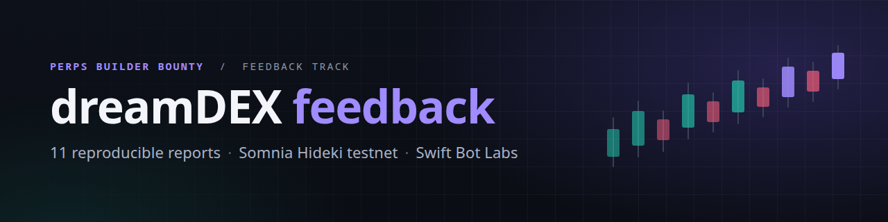
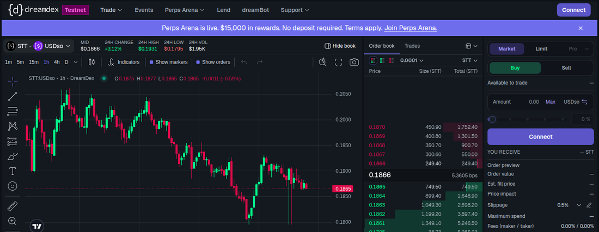
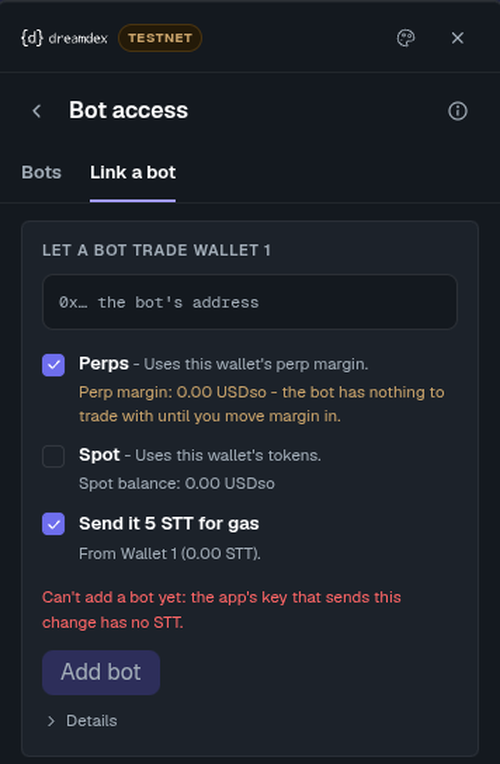
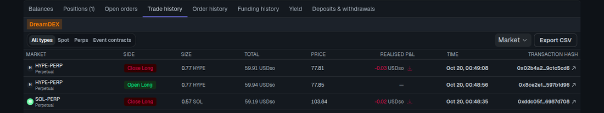
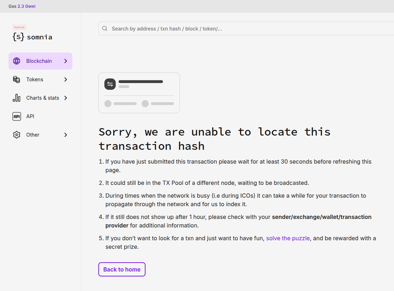

<p align="center">
  
</p>

<p align="center">
  
  
  
  
</p>

Eleven issue reports for the **dreamDEX Perps Builder Bounty (Feedback track)**, found on the Somnia Hideki
testnet ("Tokyo" region, chain id 50383). Each one is a single Markdown file in [`feedback/`](feedback) that follows the
bounty template (Severity, Area, Steps to reproduce, Expected, Actual, Evidence, Environment). Each also has a
one-command reproduction or exact manual steps, plus saved output in [`evidence/`](evidence). On **2026-10-20 (02:35–02:41 UTC)**
we re-ran the read-only checks for 01–07, 10 and 11 (for 11, the explorer side), and every one still reproduces. For 08 and 09
only the docs text was re-checked, and it is unchanged ([re-check log](evidence/recheck_2026-10-20T0235Z.txt)).

**Severity** (as filed): 

 · Jump to: [Blocking now](#blocking-now) ·
[Normal](#normal) · [Minor](#minor) · [Fix checklist](#fix-checklist) · [Index](#index) · [Quick start](#quick-start)

## Blocking now

These four stop users or developers today, ranked by impact. All three major reports are in this group.

### #10 · Every perps route redirects to the STT-USDso spot market
 &nbsp;`app`

**Impact:** nobody can open the perps trading view in the app while the Perps Arena is running. The nav, the logo, the
Arena's **Start trading** / **Start Trading Now** buttons and the market selector's perp rows all end on STT-USDso spot,
whether the user is logged in or not.



**Repro:** `curl -sI https://app.testnet.dreamdex.io/trade/perps/tokyo/BTC-PERP | grep -i location` → `location: /trade`<br>
[Report](feedback/10-app-every-perps-route-redirects-to-the-stt-spot-market.md) ·
[Evidence](evidence/perps_redirect_2026-10-19.txt) · First reported
[2026-10-19 19:42 UTC](https://github.com/swiftbotlab/dreamdex-feedback/commit/f5cef3d) · Re-checked 2026-10-20 02:36 UTC:
still `307 → /trade → 307 → /trade/spot/tokyo/STT:USDso`

### #01 · Paper USDso self-claim reverts for every caller with `SelfClaimDisabled()`
 &nbsp;`docs` `contracts`

**Impact:** the developer page offers one route to paper USDso, `claimPerpVoucher`, and it cannot work. `claim()` reverts with
`0x3e31dcc2` before any of the documented checks. The credits that do land are operator batch pushes.

**Repro:** `node scripts/claim_from.mjs 0x000000000000000000000000000000000000dEaD` → `REVERT 0x3e31dcc2`<br>
[Report](feedback/01-paper-usdso-self-claim-disabled-on-chain.md) · [Evidence](evidence/onchain_txs_2026-10-19.txt) ·
First reported [2026-10-19 09:41 UTC](https://github.com/swiftbotlab/dreamdex-feedback/commit/66e8188) · Re-checked
2026-10-20 02:35 UTC: same revert for a fresh address, an active trader and an `isClaimed` account

### #02 · SDK says `eligible: true` while `claim()` reverts, and the error is missing from `contractErrorsAbi`
 &nbsp;`SDK`

**Impact:** `getPerpVoucherEligibility` tells a fresh address it is eligible. `claimPerpVoucher` then fails with a revert
the SDK cannot decode. The bounty's own "Get test funds" sample is built on this pair of calls.

**Repro:** `node scripts/voucher_check.mjs` → all six eligibility reads pass, then `"data":"0x3e31dcc2"`<br>
[Report](feedback/02-sdk-voucher-eligibility-ignores-self-claim-disabled.md) ·
[Evidence](evidence/recheck_2026-10-20T0235Z.txt) · First reported
[2026-10-19 09:41 UTC](https://github.com/swiftbotlab/dreamdex-feedback/commit/66e8188) · Re-checked 2026-10-20 02:35 UTC
(0.32.1 is still npm `latest`)

### #04 · Indexer `MarginEvents` query used by the SDK fails for active accounts
 &nbsp;`API` `SDK`

**Impact:** the documented portfolio-return recipe (`kinds: Deposit, Credited, Withdraw`) fails after about 10.5 s with a
generic `database query error`, and it fails for exactly the accounts the recipe is meant for.

**Repro:** `bash scripts/indexer_timing.sh` → `SDK shape … 10.5s ERROR` (×3)<br>
[Report](feedback/04-indexer-margin-events-query-times-out.md) ·
[Evidence](evidence/indexer_timing_2026-10-19T1504Z.txt) · First reported
[2026-10-19 09:41 UTC](https://github.com/swiftbotlab/dreamdex-feedback/commit/66e8188) · Re-checked 2026-10-20 02:35 UTC:
3/3 `ERROR` at 10.5–10.7 s

## Normal

### #03 · Docs block six markets for paper USDso; the chain allows all 21
 &nbsp;`docs`

**Impact:** a bot that trusts the docs' market table refuses six markets that a voucher account can trade
(`isVoucherMarketAllowed` is `true` for all 21 pools).

**Repro:** `node scripts/survey.mjs > survey.json` → `voucherAllowed: true` for every pool<br>
[Report](feedback/03-paper-usdso-market-allowlist-docs-vs-chain.md) ·
[Evidence](evidence/survey_2026-10-20T0236Z.json) · First reported
[2026-10-19 09:41 UTC](https://github.com/swiftbotlab/dreamdex-feedback/commit/66e8188) · Re-checked 2026-10-20 02:36 UTC:
chain 21/21, docs sentence unchanged

### #05 · Perps guide documents `getMarginEvents` options that 0.32.1 does not have
 &nbsp;`docs` `SDK`

**Impact:** the documented trading-gain recipe throws on `CreditReclaimed`. Its `sinceBlock` / `toBlock` are ignored, so it
would also count deposits made before the window, with no error.

**Repro:** `npm pack @somnia-chain/markets-sdk@0.32.1 && tar xzf somnia-chain-markets-sdk-0.32.1.tgz && grep -c sinceBlock package/src/perp/history.ts` → `0`<br>
[Report](feedback/05-sdk-perps-guide-documents-getmarginevents-options-that-0.32.1-does-not-have.md) · Evidence: source
lines quoted in the report · First reported
[2026-10-19 09:41 UTC](https://github.com/swiftbotlab/dreamdex-feedback/commit/66e8188) · Re-checked 2026-10-20 02:40 UTC

### #06 · Errors page lacks the perp errors; wrong-scale revert message differs
 &nbsp;`docs`

**Impact:** the developer page sends readers to an Errors page that lists none of the perp, MarginBank or voucher errors. A
wrong-scale order reverts with `ERC20: insufficient allowance`, so a developer grepping logs for the documented message finds nothing.

**Repro:** `node scripts/sim_orders.mjs package/src/contractErrorsAbi.ts` (after the `npm pack` step in #05)<br>
[Report](feedback/06-errors-page-lacks-perp-errors-and-wrong-scale-message-differs.md) ·
[Evidence](evidence/onchain_txs_2026-10-19.txt) · First reported
[2026-10-19 09:41 UTC](https://github.com/swiftbotlab/dreamdex-feedback/commit/66e8188) · Re-checked 2026-10-20 02:40 UTC:
both halves unchanged

### #07 · Indexer `Market.markPrice` lags the chain by 15 to 40 minutes
 &nbsp;`API` `docs`

**Impact:** `listPerpMarkets()` returns a mark that is tens of minutes old while the indexer itself is at the chain head.
In the 15:08 UTC run the row's mark was up to 2.9 % off the chain.

**Repro:** `node scripts/mark_lag.mjs` → per-market row age and bps difference<br>
[Report](feedback/07-indexer-market-markprice-lags-chain-by-15-40-minutes.md) ·
[Evidence](evidence/mark_lag_2026-10-19T1508Z.txt) · First reported
[2026-10-19 09:41 UTC](https://github.com/swiftbotlab/dreamdex-feedback/commit/66e8188) · Re-checked 2026-10-20 02:36 UTC:
rows 17–42 min old, up to 72 bps off

## Minor

### #08 · New accounts can't Link a bot ("no STT"), and nothing says where STT comes from
 &nbsp;`app` `docs`

**Impact:** a new account sees "Can't add a bot yet … has no STT". Neither the app nor the docs say where STT comes from. The only
source we found is a Telegram faucet that pays on Shannon, and the app then bridges the STT without telling the user.



**Repro:** manual (app UI; report steps 1–5)<br>
[Report](feedback/08-app-link-a-bot-blocked-for-new-accounts-no-stt-source.md) ·
[Evidence](evidence/onchain_txs_2026-10-19.txt) · First reported
[2026-10-19 10:58 UTC](https://github.com/swiftbotlab/dreamdex-feedback/commit/f2a1e30), corrected 15:20 UTC ·
Docs re-checked 2026-10-20 02:37 UTC (no STT source in page text); app flow last run 2026-10-19 14:29–14:40 UTC

### #09 · Documented perp gas cost is about 10× below what a new sender pays
 &nbsp;`docs` `SDK`

**Impact:** at the 6 gwei base fee a new sender must pay, one minimal resting order costs 0.0141 STT, which is 4.7× the documented
maximum. A bot that budgets gas from the page runs out an order of magnitude early.

**Repro:** `node scripts/perp_gas_sample.mjs 0xD6Cb1DD58580B84D76068aC21594219ce03aeddf 0x4181dd08E73BbCdd1Ba3E615A18f6abD941b94C0 0xB483ec1fb34996638677c20ab087b16F1896FA53` (read-only; `fee_floor_test.mjs` sends transactions)<br>
[Report](feedback/09-docs-perp-gas-cost-range-is-10x-below-what-a-new-sender-pays.md) ·
[Evidence](evidence/fee_floor_test_2026-10-19.txt) · First reported
[2026-10-19 15:23 UTC](https://github.com/swiftbotlab/dreamdex-feedback/commit/b69748b) · Docs figure re-checked
2026-10-20 02:37 UTC; transaction costs measured 2026-10-19 14:36–15:20 UTC

### #11 · Trade / Order history tx links open the Shannon explorer, which can't find Hideki transactions
 &nbsp;`app`

**Impact:** every Transaction hash link in the account history leads to "unable to locate this transaction hash". The TRADER card's
wallet link also points to Shannon. The app already configures the right Hideki explorer for this region.

<br>


**Repro:** `curl -s https://shannon-explorer.somnia.network/api/v2/transactions/0xdafc8e6a5cd68e0f20ec1dabc9016bce0d6e54fd9b105ec5f92026385575acd2` → `{"message":"Not found"}`<br>
[Report](feedback/11-app-trade-history-tx-links-open-the-shannon-explorer-which-cannot-find-hideki-txs.md) ·
[Evidence](evidence/trade_history_explorer_links_2026-10-19.txt) · First reported
[2026-10-19 19:45 UTC](https://github.com/swiftbotlab/dreamdex-feedback/commit/cf5d7ae) · Explorer side re-checked
2026-10-20 02:37 UTC (still 404; Hideki receipt status 1)

## Fix checklist

One line per issue (area, where, expected behaviour), ready to paste into a tracker:

- [ ] **#10 app**: `/trade/perps/tokyo/<MARKET>-PERP` (Next.js middleware or `redirects()`) should serve the perps view, not a `307` to `/trade`. If perps is off on purpose, show a notice and stop linking the Arena buttons to it.
- [ ] **#01 contracts/docs**: `VoucherDistributor` `0x2ACD9EFdA721450906bfE1bef3edE269636E42C4` `claim()`: enable self-claim, or say on the developer page that paper USDso is granted by the Arena and caveat the `claimPerpVoucher` sample.
- [ ] **#02 SDK**: `src/perp/voucher.ts` `getPerpVoucherEligibility`: add a `selfClaimDisabled` reason, checked first. Add `SelfClaimDisabled()` (`0x3e31dcc2`) to `src/contractErrorsAbi.ts`.
- [ ] **#04 indexer**: `MarginEvent` needs a composite index on `(account, kind, timestamp DESC, id)`, or the SDK should order by id. Return "statement timeout" instead of `database query error`.
- [ ] **#03 docs**: the Paper USDso column on `/docs/trading/perps-testnet` and the margin-and-liquidations page: regenerate from `isVoucherMarketAllowed`, or fix the allowlist on chain.
- [ ] **#05 docs/SDK**: the scoring recipe on `/markets/somnia-markets/typescript/perps`: ship `sinceBlock`/`toBlock` and `CreditReclaimed`, or rewrite it to filter by timestamp with the kinds that exist.
- [ ] **#06 docs**: `/docs/developers/contracts/errors`: add a Perps table (MarginBank, PerpPool, VoucherDistributor, including `0x3e31dcc2`). The wrong-scale paragraph should say `ERC20: insufficient allowance`.
- [ ] **#07 indexer/docs**: `Market.markPrice`: refresh on mark/funding updates, or document the cadence and point to `getPerpState` / `tryGetMarkPrice`.
- [ ] **#08 app/docs**: the Link a bot red message and "Get test funds" should name the STT source (faucet, pays on Shannon, the app bridges it), or the relayer should pay for the operator grant.
- [ ] **#09 docs**: the gas-cost sentence on `/docs/developers/perps-testnet` should quote costs at 6 gwei (about 0.01–0.015 STT per resting order) or state the gas price it assumes. Resize "Send it 5 STT" to match.
- [ ] **#11 app**: `getExplorerTxUrl` / `getExplorerTxUrlForChain` / `getExplorerAddressUrl` should build links from the row's region (Tokyo → Hideki markets explorer) and add chain 50383.

## Index

| # | Severity | Area | Issue | First reported (UTC) |
|---|---|---|---|---|
| 01 | major | docs, contracts | [Paper USDso self-claim reverts with `SelfClaimDisabled()` for every caller](feedback/01-paper-usdso-self-claim-disabled-on-chain.md) | [2026-10-19 09:41](https://github.com/swiftbotlab/dreamdex-feedback/commit/66e8188) |
| 02 | major | SDK | [`getPerpVoucherEligibility` says eligible while `claim()` reverts; error missing from `contractErrorsAbi`](feedback/02-sdk-voucher-eligibility-ignores-self-claim-disabled.md) | [2026-10-19 09:41](https://github.com/swiftbotlab/dreamdex-feedback/commit/66e8188) |
| 03 | normal | docs | [Docs block six markets for paper USDso; the chain allows all 21](feedback/03-paper-usdso-market-allowlist-docs-vs-chain.md) | [2026-10-19 09:41](https://github.com/swiftbotlab/dreamdex-feedback/commit/66e8188) |
| 04 | major | API, SDK | [Indexer `MarginEvents` query used by the SDK times out for an active account](feedback/04-indexer-margin-events-query-times-out.md) | [2026-10-19 09:41](https://github.com/swiftbotlab/dreamdex-feedback/commit/66e8188) |
| 05 | normal | docs, SDK | [Perps guide documents `getMarginEvents` options 0.32.1 does not have](feedback/05-sdk-perps-guide-documents-getmarginevents-options-that-0.32.1-does-not-have.md) | [2026-10-19 09:41](https://github.com/swiftbotlab/dreamdex-feedback/commit/66e8188) |
| 06 | normal | docs | [Errors page lacks the perp errors; wrong-scale revert message differs](feedback/06-errors-page-lacks-perp-errors-and-wrong-scale-message-differs.md) | [2026-10-19 09:41](https://github.com/swiftbotlab/dreamdex-feedback/commit/66e8188) |
| 07 | normal | API, docs | [Indexer `Market.markPrice` lags the chain by 15 to 40 minutes](feedback/07-indexer-market-markprice-lags-chain-by-15-40-minutes.md) | [2026-10-19 09:41](https://github.com/swiftbotlab/dreamdex-feedback/commit/66e8188) |
| 08 | minor | app, docs | [New accounts can't Link a bot ("no STT") and nothing says where STT comes from](feedback/08-app-link-a-bot-blocked-for-new-accounts-no-stt-source.md) | [2026-10-19 10:58](https://github.com/swiftbotlab/dreamdex-feedback/commit/f2a1e30) |
| 09 | minor | docs, SDK | [Documented perp gas cost is about 10× below what a new sender pays](feedback/09-docs-perp-gas-cost-range-is-10x-below-what-a-new-sender-pays.md) | [2026-10-19 15:23](https://github.com/swiftbotlab/dreamdex-feedback/commit/b69748b) |
| 10 | normal | app | [Every perps route, including the Arena's "Start trading", redirects to the STT-USDso spot market](feedback/10-app-every-perps-route-redirects-to-the-stt-spot-market.md) | [2026-10-19 19:42](https://github.com/swiftbotlab/dreamdex-feedback/commit/f5cef3d) |
| 11 | minor | app | [Trade/Order history tx links open the Shannon explorer, which can't find Hideki transactions](feedback/11-app-trade-history-tx-links-open-the-shannon-explorer-which-cannot-find-hideki-txs.md) | [2026-10-19 19:45](https://github.com/swiftbotlab/dreamdex-feedback/commit/cf5d7ae) |

"First reported" is the author time of the commit that added the report file (`git log --diff-filter=A --format=%aI -- feedback/<file>`).

## Quick start

<details>
<summary><b>Run the reproductions</b> (Node 18+, npm, curl)</summary>

```bash
git clone https://github.com/swiftbotlab/dreamdex-feedback && cd dreamdex-feedback
npm ci                                   # installs exactly viem 2.57.7 from package-lock.json
node scripts/voucher_check.mjs           # #01/#02: eligibility reads pass, claim() reverts 0x3e31dcc2
bash scripts/indexer_timing.sh           # #04 (also needs bc)
node scripts/mark_lag.mjs                # #07

# #02 and #06 decode selectors against the SDK's error ABI. npm pack only downloads the tarball; nothing in it is run.
npm pack @somnia-chain/markets-sdk@0.32.1 && tar xzf somnia-chain-markets-sdk-0.32.1.tgz
node scripts/errsel.mjs package/src/contractErrorsAbi.ts 0x3e31dcc2      # -> UNKNOWN
node scripts/sim_orders.mjs package/src/contractErrorsAbi.ts
```

Tested on Node 22.22.1. The scripts are plain `viem`; the SDK is never executed (ABIs are copied from its `readsAbi.ts` /
`tradeAbi.ts`). Everything is read-only (`eth_call`, GraphQL, HTTP) **except `fee_floor_test.mjs`**, which sends three
self-transfers and needs `PRIVATE_KEY` of a throwaway testnet key.

| Endpoint | Value |
|---|---|
| Chain | Somnia Hideki testnet ("Tokyo" region), chain id **50383**, gas token STT |
| RPC | `https://api.hideki2.infra.testnet.somnia.network` (hard-coded; `survey.mjs` also honours `RPC=`) |
| Indexer (GraphQL) | `https://hideki-dev.smk.somnia.host/v1/graphql` |
| App | `https://app.testnet.dreamdex.io` |

**Evidence naming:** `evidence/<topic>_<YYYY-MM-DD>[T<HHMM>Z].txt|json` is script output, with UTC time.
`evidence/<what-it-shows>.png` is a screenshot. Every real transaction is in
[`evidence/onchain_txs_2026-10-19.txt`](evidence/onchain_txs_2026-10-19.txt). The undated `indexer_timing.txt`,
`mark_lag.txt` and `survey.json` are the first runs (2026-10-19 about 09:40 UTC), committed with reports 01–07.
</details>

<details>
<summary><b>Scripts and the reports they reproduce</b></summary>

| Script | Reports | Command |
|---|---|---|
| [`claim_from.mjs`](scripts/claim_from.mjs) | 01, 02 | `node scripts/claim_from.mjs <address...>` |
| [`voucher_check.mjs`](scripts/voucher_check.mjs) | 02, 01 | `node scripts/voucher_check.mjs [address]` |
| [`survey.mjs`](scripts/survey.mjs) | 03, 05 | `node scripts/survey.mjs > survey.json` |
| [`indexer_timing.sh`](scripts/indexer_timing.sh) | 04 | `bash scripts/indexer_timing.sh [account]` |
| [`errsel.mjs`](scripts/errsel.mjs) | 02, 06 | `node scripts/errsel.mjs <contractErrorsAbi.ts> <selector...>` |
| [`sim_orders.mjs`](scripts/sim_orders.mjs) | 06 | `node scripts/sim_orders.mjs <contractErrorsAbi.ts> [from] [pool]` |
| [`sim_cap.mjs`](scripts/sim_cap.mjs) | 06 | `node scripts/sim_cap.mjs` |
| [`mark_lag.mjs`](scripts/mark_lag.mjs) | 07 | `node scripts/mark_lag.mjs` |
| [`perp_gas_sample.mjs`](scripts/perp_gas_sample.mjs) | 09 | `node scripts/perp_gas_sample.mjs <pool...>` |
| [`fee_floor_test.mjs`](scripts/fee_floor_test.mjs) | 09 | `PRIVATE_KEY=0x… node scripts/fee_floor_test.mjs` (**sends transactions**) |
| [`encode_order.mjs`](scripts/encode_order.mjs) | 01, 04–07, 09 | `node scripts/encode_order.mjs <wrongscale\|perpbid\|cancel\|…> …` (calldata only) |
| [`rpccap.mjs`](scripts/rpccap.mjs) | (support) | `node scripts/rpccap.mjs`: RPC capability probe |

Reports 08, 10 and 11 are app behaviour. Their steps are in each report, and 10 and 11 have a `curl` check (see the cards above).
</details>

<details>
<summary><b>Method and environment</b></summary>

- Each report was reproduced against the live testnet with plain JSON-RPC / GraphQL requests or a minimal viem script. The
  requests and responses are quoted inside the report.
- `@somnia-chain/markets-sdk` 0.32.1 (source read from the npm tarball, never executed); RPC
  `https://api.hideki2.infra.testnet.somnia.network`; indexer `https://hideki-dev.smk.somnia.host/v1/graphql`.
- Some reports are also backed by real testnet transactions. They were sent from a throwaway key
  (`0x2A11e7388D1D2F9690f2636846d44b478f61bF08`) that got its gas through the app's Link a bot flow, and they are listed
  with status, gas and fee in [`evidence/onchain_txs_2026-10-19.txt`](evidence/onchain_txs_2026-10-19.txt).
- App reports (08, 10, 11): app.testnet.dreamdex.io in Chrome 155 on Linux, Privy e-mail login, Somnia Account wallet
  `0x0e7E8DF6Eac2E14165b4fA4CB2BD4e445d0E3817`.
</details>

## Notes

- **Corrections** to a report are marked in the report itself ("Corrected …"). They are never silent edits. Example: report 08
  was corrected on 2026-10-19 at 15:20 UTC once we found a faucet, and its severity was lowered.
- **Security:** nothing here is a security vulnerability. Those go privately to security@dreamdex.io, not to this repo.
- **Contact:** Telegram [@swiftbotlabs](https://t.me/swiftbotlabs) · DoraHacks `swiftbotlab`. Maintained by Swift Bot Labs.
