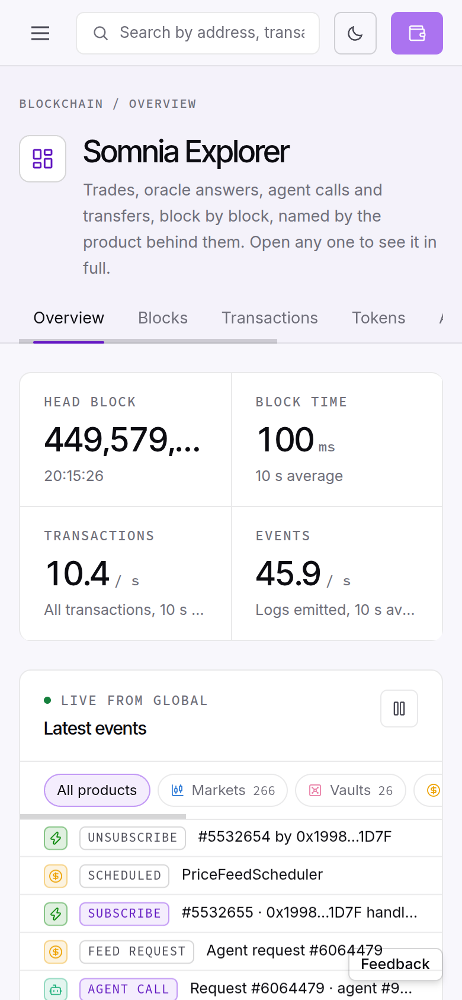

# Explorer (phone): the overview's HEAD BLOCK tile cuts the block number to "449,579,…" at every phone width (360–430 px), with no tooltip
Severity: normal
Area: explorer

> **Summary.** The first figure on the explorer's home page is the head block. On a phone it is unreadable: the nine-digit
> number ("449,579,561") is set in a 28 px `truncate` span inside a two-column tile grid, so the span is 123–158 px wide
> while the number needs 160 px. It ends in an ellipsis: "449,579,…". The last three digits are the ones that change
> every block, and those are the ones cut. The element has no `title`, so they cannot be revealed. At 1280 px the full
> number fits (193 px). Mainnet is past 449 million blocks, so the number only gets longer (it gains a digit and a comma at 1 billion).

> **Checked 2026-10-27 at 14:33, 14:36–14:38, 14:45–14:46 and 14:55–14:56 UTC**, Chrome 155 device emulation
> (mobile, DPR 2), https://new.explorer.somnia.network/. Evidence: `evidence/46/head_block_tile_2026-10-27T1445Z.txt`,
> `evidence/46/overview_390x844_2026-10-27T1445Z.png`, `evidence/46/overview_390x844_2026-10-27T1433Z.png`.



## Steps to reproduce
1. Open https://new.explorer.somnia.network/ in Chrome device mode at 390 × 844 (or on a phone).
2. Read the HEAD BLOCK tile.
3. Measure it in the console:
   ```js
   const el = [...document.querySelectorAll('main *')].find(e => e.childElementCount === 0 && /^\d{3},\d{3},\d{3}$/.test(e.textContent.trim()));
   [el.textContent, el.clientWidth, el.scrollWidth, el.className, el.title]
   ```
   Or run `python3 evidence/46/stat_tiles.py <CDP target id> 390` (needs `websocket-client`) against a Chrome with remote
   debugging on port 9222.

## Expected
The whole head block number is visible on phones, as it is on desktop, or at least can be revealed (a `title` or a tap).

## Actual
`evidence/46/head_block_tile_2026-10-27T1445Z.txt`:

| viewport | text | element width (`clientWidth`) | text width (`scrollWidth`) | shown |
|---|---|---|---|---|
| 360 px | 449,579,678 | 123 | 160 | cut |
| 390 px | 449,579,561 | 138 | 160 | cut ("449,579,…", screenshot) |
| 430 px | 449,579,817 | 158 | 160 | cut |
| 1280 px | 449,579,943 | 193 | 193 | full |

The element is `<… class="display tabular truncate text-[28px] leading-none text-fg">`, with `text-overflow: ellipsis`,
`white-space: nowrap` and no `title`. It sits in a tile `flex min-w-0 flex-col gap-2 px-5 py-4`, in a grid of
`178.5px 178.5px` at 390 px (`163.5px` at 360, `198.5px` at 430; four `234px` columns at 1280).

The same tiles also cut two captions on phones (`evidence/46/stat_tiles_2026-10-27T1455Z.txt`): "All transactions, 10 s
average" (172 px of text in a 123–158 px box at 360–430 px, so it shows as "All transactions, 10 s …") and "Logs emitted,
10 s average" (158 px in 123–138 px at 360–390 px). The Block time and Events values fit.

## Evidence
- `evidence/46/overview_390x844_2026-10-27T1445Z.png` and `evidence/46/overview_390x844_2026-10-27T1433Z.png`: two
  captures at 390 px, "449,579,…" and "449,572,…".
- `evidence/46/head_block_tile_2026-10-27T1445Z.txt` and `evidence/46/stat_tiles_2026-10-27T1455Z.txt`: the
  measurements above (the second lists every text in the four tiles, with box and text widths, at 390/360/430/1280 px).
- `evidence/46/head_block_tile.py`, `evidence/46/stat_tiles.py`: the measuring scripts (CDP; they emulate the width,
  load the page and read the elements).

## Suggested fix
On narrow screens, use a smaller size for this value (e.g. `text-[20px] sm:text-[28px]`: 449,579,561 then takes about
114 px, inside the 123 px box at 360 px) or let it wrap/shrink (`text-[clamp(18px,6vw,28px)]`). Alternatively, stack the stat tiles in one column
below ~440 px. Add `title={blockNumber}` so a cut value can still be read, and let the two captions wrap instead of `truncate`.

## Environment
- Explorer: https://new.explorer.somnia.network as served 2026-10-27
- Chrome 155 on Linux, device emulation 360/390/430 × 844 mobile (DPR 2, iPhone user agent) and 1280 × 900 desktop
- Somnia mainnet (Global), chain id 5031

**Distinct from** our #36, which is the dreamDEX Perps Arena hero card on app.testnet.dreamdex.io. This is the new
explorer's home page.
