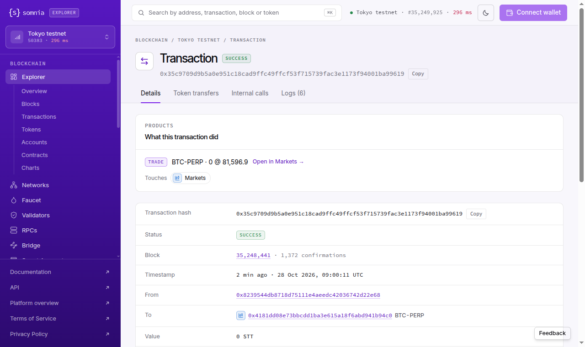

# Explorer (Tokyo): perp trade, order, position and liquidation sizes are divided by 1e18 whatever the base token's decimals, so 12 of the 21 perp markets show wrong sizes: "BTC-PERP · 0 @ 81,596.9" for a 0.08438 BTC fill, "5,100,000 @ 4.7375" for 5.1 NEAR
Severity: major
Area: explorer

> **Summary.** On the Tokyo testnet, the explorer turns dreamDEX events into one-line rows: the TRADE line in a
> transaction's "What this transaction did" card, the ORDER / TRADE / POSITION rows of the live feed on `/tokyo`, and
> the TRADE / POSITION / LIQUIDATION rows of the Logs tab. The price in those rows is right. The size is not, for most
> perp markets. A PerpPool's `OrderFilled.quantityFilled`, `OrderPlaced.fullQuantity`, `PositionUpdated.newSize` and
> `PositionLiquidated.sizeDelta` are in the base token's own decimals, and the explorer divides them by 10^18 for every
> perp pool. 12 of the 21 open Tokyo perp markets have a base token that is not 18-decimal (on-chain `decimals()`:
> BTC, DOGE, ZEC 8; SOL, SUI, TAO 9; XLM 7; ADA, HYPE, XRP, PUMP 6; NEAR 24). For the eleven with fewer decimals every
> size rounds to **0** ("BTC-PERP · 0 @ 81,596.9" for 0.08438 BTC; "LIQUIDATION … · 0 @ 103.2515" for a 202.59 SOL
> liquidation). For NEAR every size is **10^6 times too large** ("5,100,000 @ 4.7375" for 5.1 NEAR). Sizes on
> 18-decimal perps (ETH, LIT) are right, and so are sizes on spot markets with an 8-decimal base (WBTC/USDso spot:
> "Buy 0.00175" for raw 175000). So the fault is in the perp path only.
>
> This is not the "pool address instead of market name" problem already reported for the Tokyo TRADE card. Markets the
> explorer does name show the wrong size too: "BTC-PERP · 0", "SOL-PERP · 0".

> **Checked 2026-10-28 at 09:01, 09:13 and 09:21 UTC by script, and in the browser at 08:52–09:14 UTC (transaction pages,
> the live feed, the Logs tab), Tokyo testnet (Hideki, chain 50383), logged out, no wallet.** Same result each time.
> Evidence: `evidence/48/trade_size_check_2026-10-28T0901Z.txt`, `evidence/48/trade_size_check_2026-10-28T0921Z.txt`, `evidence/48/ui_tokyo_tx_btc_perp_trade_card_2026-10-28T0902Z.png`.



## Why it matters
The explorer is where a trader checks what a fill or a liquidation did, and where a bot developer checks a test order.
On BTC, SOL, DOGE, ZEC, ADA, XRP and six other markets, every order, fill, position and liquidation row reads 0, so
the explorer seems to say that the order filled nothing or that a position is flat. A 202.59 SOL liquidation reads
"LIQUIDATION 0x1028…3919 · 0 @ 103.2515", and the 192.91 SOL short left after one of its fills reads "size -0". On NEAR it is the other way round: a
5.1 NEAR order (about 24 USDso) reads as 5,100,000 NEAR (about 24 million USDso). Either way, the figures misstate
position sizes.

## Steps to reproduce
`node evidence/48/trade_size_check.mjs` (read-only; viem from the repo's `package.json`). For each transaction the script
reads the receipt from the Tokyo RPC, decodes `OrderFilled` / `PositionUpdated`, reads the pool's base token through
`PerpPoolFactory.getBaseTokenForPool(pool)` and its `decimals()`, and prints the TRADE line from the server-rendered
explorer page. `node evidence/48/perp_base_decimals.mjs` lists all 21 perp pools with their base decimals.

By hand:
1. Open https://explorer.testnet.somnia.network/tokyo/tx/0x35c9709d9b5a0e951c18cad9ffc49ffcf53f715739fac3e1173f94001ba99619
   (BTC-PERP fill, block 35,248,441, 09:00:11 UTC). The card reads **TRADE BTC-PERP · 0 @ 81,596.9**.
2. Read the receipt's `OrderFilled` log (pool `0x4181dd08…94c0`):
   ```sh
   curl -s -H 'content-type: application/json' https://api.hideki2.infra.testnet.somnia.network \
     --data '{"jsonrpc":"2.0","id":1,"method":"eth_getTransactionReceipt","params":["0x35c9709d9b5a0e951c18cad9ffc49ffcf53f715739fac3e1173f94001ba99619"]}' \
     | jq -r '.result.logs[] | select(.topics[0]=="0xc87f4223e9e7c4e4f39f9b34fc9d64d78cdb95d9035b3748cbde59521261a399") | .data[2:66]'
   # 000…0080c0f0 = 8,438,000
   curl -s -H 'content-type: application/json' https://api.hideki2.infra.testnet.somnia.network \
     --data '{"jsonrpc":"2.0","id":1,"method":"eth_call","params":[{"to":"0xa77fa353dac50de5c15676ac910c221a4d2bd6b5","data":"0x313ce567"},"latest"]}'
   # decimals() of the pool's base token (BTC) = 8 -> 8,438,000 / 1e8 = 0.08438 BTC
   ```
3. Open https://explorer.testnet.somnia.network/tokyo/tx/0x2441c500227410e25a047f06e964e9d2dc3cb85f5e0055f9a384f11530ec360b
   (NEAR-PERP, 24-decimal base). The card reads **TRADE 0x1cd1…a454 · 5,100,000 @ 4.7375**; the chain says 5.1 NEAR.
4. Open https://explorer.testnet.somnia.network/tokyo and watch the feed: ORDER / TRADE / POSITION rows for SOL-PERP,
   BTC-PERP, ZEC, DOGE and the others read "Buy 0 @ …", "Sell 0 @ …", "size -0"; WBTC/USDso spot rows read correctly.

## Expected
Size = raw quantity / 10^(base token decimals), as the explorer already does for spot rows. The BTC fill above
should read "BTC-PERP · 0.08438 @ 81,596.9", the NEAR fill "· 5.1 @ 4.7375".

## Actual
`evidence/48/trade_size_check_2026-10-28T0901Z.txt` (abridged; the 09:13 and 09:21 runs are identical):

```
0x05fa91ea…e2ec  pool 0xdcb0…2a3f  base LIT (18 decimals)
  chain  OrderFilled quantityFilled raw 15000000000000000000 = 15 LIT @ 3.0162
  page   What this transaction did | Trade | 0xdcb0…2a3f · 15 @ 3.0162            <- right (18 decimals)
0x025abb3d…2d0f  pool 0xd6cb…addf  base ETH (18 decimals)
  chain  OrderFilled quantityFilled raw 4000000000000000 = 0.004 ETH @ 2369.8
  page   Trade | ETH-PERP · 0.004 @ 2,369.8                                     <- right (18 decimals)
0x35c9709d…9619  pool 0x4181…94c0  base BTC (8 decimals)
  chain  OrderFilled quantityFilled raw 8438000 = 0.08438 BTC @ 81596.9  (as 18 decimals: 0.000000000008438)
  page   Trade | BTC-PERP · 0 @ 81,596.9
0xbb13acd8…77b6  pool 0xc410…40df  base DOGE (8 decimals)
  chain  OrderFilled quantityFilled raw 12000000000 = 120 DOGE @ 0.08004
  page   Trade | 0xc410…40df · 0 @ 0.08004
0xd16c3031…c6ca  pool 0x2a73…f050  base ZEC (8 decimals)      chain 0.009 ZEC      page · 0 @ 1,313.51
0x7c1176f7…244f  pool 0xb483…fa53  base SOL (9 decimals)      chain 0.1 SOL        page SOL-PERP · 0 @ 102.68
0x23c584bd…0eb4  pool 0x34fa…619d  base ADA (6 decimals)      chain 46 ADA         page · 0 @ 0.2065
0x2441c500…360b  pool 0x1cd1…a454  base NEAR (24 decimals)
  chain  OrderFilled quantityFilled raw 5100000000000000000000000 = 5.1 NEAR @ 4.7375  (as 18 decimals: 5100000)
  page   Trade | 0x1cd1…a454 · 5,100,000 @ 4.7375
```

Logs tab of a SOL-PERP liquidation (`evidence/48/ui_logs_tab_sol_liquidation_rows_2026-10-28T0914Z.txt`, tx
`0x926e6a27…88d7`): `LIQUIDATION 0x1028…3919 · 0 @ 103.2515` for `PositionLiquidated.sizeDelta` 202,590,000,000
(202.59 SOL), and `POSITION 0x1028…3919 · size -0` for `newSize` -192,910,000,000 (-192.91 SOL).

## Evidence
- `evidence/48/trade_size_check_2026-10-28T0901Z.txt`, `…T0913Z.txt`, `…T0921Z.txt`: three runs,
  8 transactions (two 18-decimal controls, six affected markets), chain values next to the page's TRADE line.
- `evidence/48/perp_base_decimals_2026-10-28T0916Z.txt`: all 21 open perp pools from
  `PerpPoolFactory.getPerpPoolStatuses()` with on-chain base decimals; 12 are not 18.
- `evidence/48/feed_spot_control_vs_perp_2026-10-28T0858Z.txt`: the live feed at the same block. A WBTC/USDso **spot**
  order (8 decimals, raw 175000) reads "Buy 0.00175". The ZEC **perp** orders (8 decimals, raw 532500000 = 5.325 ZEC) read "Buy 0" / "Sell 0".
- `evidence/48/ui_logs_tab_sol_liquidation_rows_2026-10-28T0914Z.txt`: LIQUIDATION and POSITION rows in the Logs tab.
- `evidence/48/ui_tokyo_tx_btc_perp_trade_card_2026-10-28T0902Z.png`, `evidence/48/ui_tokyo_tx_near_perp_trade_card_2026-10-28T0902Z.png`.
- Scripts: `evidence/48/trade_size_check.mjs`, `evidence/48/perp_base_decimals.mjs`.

## Suggested fix
Resolve the base decimals per perp pool and use them for every size field: `PerpPoolFactory.getBaseTokenForPool(pool)`
→ ERC-20 `decimals()` (or the Tokyo indexer's `Market.baseDecimals`), cached per pool. The fields are
`OrderFilled.quantityFilled`, `OrderPlaced.fullQuantity`/`quantityRemaining`, `PositionUpdated.newSize` and
`PositionLiquidated.sizeDelta`. Prices and USDso amounts are 1e18-scaled on every pool and are already right.

## Environment
- Explorer: https://explorer.testnet.somnia.network/tokyo/ as served 2026-10-28 (Next.js on Vercel); Tokyo testnet
  = Hideki, chain id 50383; RPC https://api.hideki2.infra.testnet.somnia.network
- PerpPoolFactory `0xE631fAEE547baeE07353E290f0562ea67d856560`; pools as listed in `perp_base_decimals_*.txt`
- Node 22 + viem 2.57.7 (read-only), curl 8.18.0, Chrome 155 on Linux (fresh browser context, no wallet)
