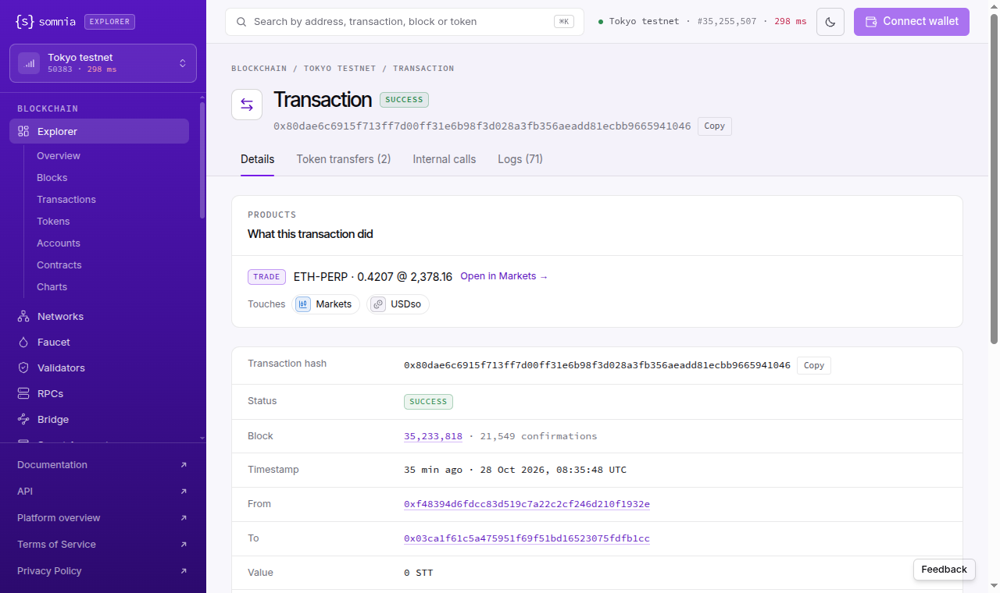

# Explorer (Tokyo): a liquidation transaction is summarised as its first small fill ("Trade · ETH-PERP · 0.4207 @ 2,378.16" for an 80.26 ETH, 191,194 USDso liquidation), sometimes as an unrelated STT/USDso spot fill, and the Details tab never says "liquidation"
Severity: major
Area: explorer

> **Summary.** On a Tokyo transaction page, the "What this transaction did" card is the explorer's one-line answer to
> what happened. For dreamDEX liquidations it shows one TRADE line taken from the first `OrderFilled` log. On the
> transactions we checked that line was 0.5–4% of the liquidated size, and once it came from another market. In
> `0x80dae6c6…1046` the LiquidationEngine liquidated account `0xF3ed…08F8`'s ETH-PERP position: **80.2601 ETH** in 13
> fills, **191,193.76 USDso** notional, a **1,911.94 USDso** liquidation fee. The card reads **"Trade · ETH-PERP · 0.4207 @
> 2,378.16"**, the first of the 13 fills. In `0x926e6a27…88d7` (202.59 SOL liquidated, 209.54 USDso fee) the card reads
> **"Trade · STT/USDso · 1.14 @ 0.1849"**. That is a spot fill on the STT/USDso pool in the same transaction, and the
> SOL-PERP liquidation is not on the card at all. The word "liquidation" appears nowhere on the Details tab. The
> explorer can decode these events: its Logs tab renders `PositionLiquidated` as "LIQUIDATION 0xF3ed…08F8 · 80.2601 @
> 2,379.21" (log #138, one of the transaction's 71 logs). The summary just does not use them.

> **Checked 2026-10-28 at 09:11, 09:14 and 09:21 UTC on four liquidations from 08:35–08:36 UTC (Tokyo testnet, Hideki, chain 50383),
> logged out, no wallet**, three times by script and once in the browser (09:12–09:13 UTC). Evidence: `evidence/49/liquidation_card_check_2026-10-28T0911Z.txt`,
> `evidence/49/liquidation_card_check_2026-10-28T0914Z.txt`, `evidence/49/ui_tokyo_tx_eth_perp_liquidation_summary_2026-10-28T0912Z.png`.



## Why it matters
A liquidated trader, or someone checking a liquidation keeper, opens the transaction and reads "Trade 0.4207 ETH". The
summary hides that a position of 80 ETH was closed, that 1,912 USDso was charged as a fee, and which account it was. A
trader who looks up a liquidation of their own SOL position sees a 1.14 STT spot trade. To find the liquidation they
have to scroll through up to 71 raw-looking log rows. The fee and keeper reward rows (#140, #141) are not decoded at all.

## Steps to reproduce
`node evidence/49/liquidation_card_check.mjs` (read-only; viem from the repo's `package.json`). It reads each receipt
from the Tokyo RPC, decodes `PositionLiquidated`, `LiquidationFeeCharged`, `LiquidationKeeperRewardPaid`,
`AccountLiquidated` and every `OrderFilled` (with the pool's base decimals from `PerpPoolFactory.getBaseTokenForPool`),
and prints the server-rendered "What this transaction did" section of the explorer page.

By hand:
1. Open https://explorer.testnet.somnia.network/tokyo/tx/0x80dae6c6915f713ff7d00ff31e6b98f3d028a3fb356aeadd81ecbb9665941046
   (block 35,233,818, 08:35:48 UTC). The card reads `TRADE ETH-PERP · 0.4207 @ 2,378.16`, `Touches Markets USDso`. Search the page for
   "liquidat": no match.
2. Open the same page with `?tab=logs`: row #138 reads `LIQUIDATION 0xF3ed…08F8 · 80.2601 @ 2,379.21`, row #143
   `LIQUIDATION 0xF3ed…08F8 · 1 positions`, and 13 TRADE rows in between (0.4207, 0.8414, 8.4148, 2.9447, 29.4514 …).
3. Open https://explorer.testnet.somnia.network/tokyo/tx/0x926e6a27368788edab0e8fb506f3445a626fb1580b48564803328116ae8888d7
   (block 35,234,014, 08:36:08 UTC): the card reads `TRADE STT/USDso · 1.14 @ 0.1849`. The Logs tab shows the SOL-PERP fills and
   the LIQUIDATION rows.
4. The liquidations come from the Tokyo indexer (`LiquidationEvent`, kind `PositionLiquidated`, at
   https://hideki-dev.smk.somnia.host/v1/graphql), and each was re-checked against the receipt.

## Expected
For a transaction whose logs include `PositionLiquidated` / `AccountLiquidated`, the card says LIQUIDATION. It gives the
account, the market, the size closed (the sum of the fills or `sizeDelta`), the mark price and the fee
(`LiquidationFeeCharged.amount`), and it does not single out one fill. For any transaction with several fills, the card
gives the total, or one line per market, not the first `OrderFilled` it finds.

## Actual
`evidence/49/liquidation_card_check_2026-10-28T0911Z.txt` (the 09:14 and 09:21 runs are identical):

```
0x80dae6c6…1046  block 35233818  logs 71
  chain  PositionLiquidated account 0xF3ed3F5b90A13b39f30759E9800ec638711008F8 pool 0xD6Cb…addf (ETH-PERP) sizeDelta 80.2601 ETH at mark 2379.2068
  chain  LiquidationFeeCharged fillNotional 191193.756493 USDso, fee 1911.93756493 USDso
  chain  AccountLiquidated 0xF3ed…08F8 positionsProcessed 1 marginStatus 2 -> 0
  chain  13 OrderFilled on 0xd6cb…addf (ETH-PERP): total 80.2601 ETH; first fill 0.4207 @ 2378.16
  page   What this transaction did | Trade | ETH-PERP · 0.4207 @ 2,378.16 | Open in | Markets | → | Touches | Markets | USDso |

0x926e6a27…88d7  block 35234014  logs 35
  chain  PositionLiquidated account 0x1028b73C72aA7f5095772C069Fa58e75C7e43919 pool 0xB483…FA53 (SOL-PERP) sizeDelta 202.59 SOL at mark 103.2515
  chain  LiquidationFeeCharged fillNotional 20954.1585 USDso, fee 209.541585 USDso
  chain  4 OrderFilled on 0xb483…fa53 (SOL-PERP): total 202.59 SOL; first fill 9.68 @ 103.39
  chain  1 OrderFilled on 0xbe6c…d35d (not a perp pool): first fill 1.14 @ 0.1849
  page   What this transaction did | Trade | STT/USDso · 1.14 @ 0.1849 | Open in | Markets | → | Touches | Markets | USDso |

0xee3c3c8f…0862  ETH-PERP sizeDelta 10.832 ETH, fee 257.43 USDso, 4 fills   page  Trade | ETH-PERP · 0.409 @ 2,376.26
0x81ab856e…1dd1  SOL-PERP sizeDelta 304.07 SOL, fee 314.30 USDso, 5 fills   page  Trade | SOL-PERP · 0 @ 103.34
```

(`0xbe6c45bf…d35d` is the STT/USDso spot pool in the Tokyo indexer. The "0" in the last line is the decimals defect of
report 48: that first fill is 9.49 SOL.)

## Evidence
- `evidence/49/liquidation_card_check_2026-10-28T0911Z.txt`, `…T0914Z.txt`, `…T0921Z.txt`:
  three runs, four liquidations, chain values next to the page's card.
- `evidence/49/ui_logs_tab_eth_liquidation_2026-10-28T0913Z.txt`: the Logs tab of the ETH liquidation. It has the
  decoded LIQUIDATION rows, the 13 TRADE rows, and the undecoded fee and keeper-reward rows (#140, #141).
- `evidence/49/ui_tokyo_tx_eth_perp_liquidation_summary_2026-10-28T0912Z.png`,
  `evidence/49/ui_tokyo_tx_sol_perp_liquidation_summary_2026-10-28T0912Z.png`: the Details tabs.
- `evidence/49/liquidation_card_check.mjs`: the script.

## Suggested fix
When a transaction's logs include LiquidationEngine events, give the summary a LIQUIDATION line built from
`PositionLiquidated` (account, pool → market, `sizeDelta` in base decimals, `markPrice`) and `LiquidationFeeCharged`
(fee). Put it before any TRADE line. For several `OrderFilled` logs on one pool, show the total size and the
size-weighted price, or "N fills", instead of the first fill. Decode `LiquidationFeeCharged` and
`LiquidationKeeperRewardPaid` in the Logs tab too; they are in the dreamDEX SDK's `liquidationEngineEventsAbi`.

## Environment
- Explorer: https://explorer.testnet.somnia.network/tokyo/ as served 2026-10-28; Tokyo testnet = Hideki, chain id 50383;
  RPC https://api.hideki2.infra.testnet.somnia.network
- LiquidationEngine (emitter) `0xa66d3c24ad4a389d863846905d8173e1017e9f4d`; PerpPoolFactory `0xE631fAEE547baeE07353E290f0562ea67d856560`
- Node 22 + viem 2.57.7 (read-only), Chrome 155 on Linux (fresh browser context, no wallet)
