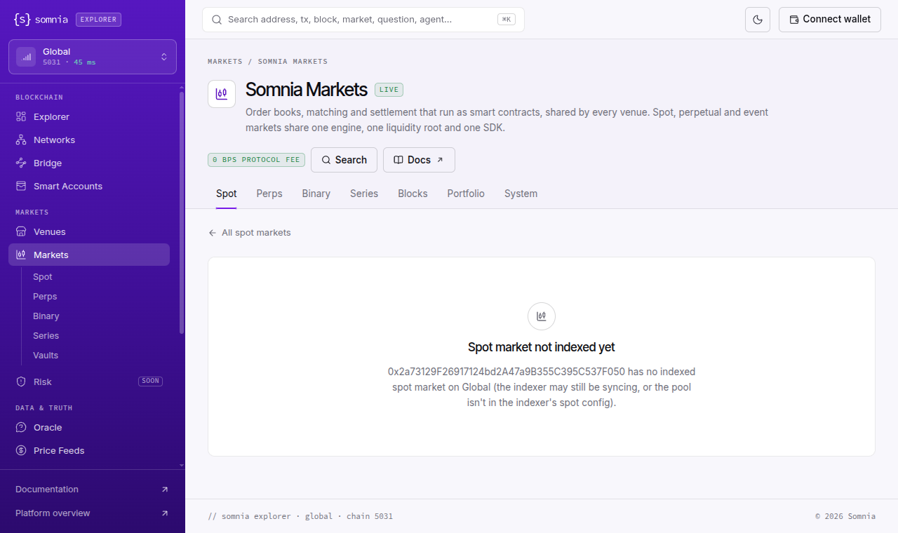

# Explorer (testnet): every Markets link on the Tokyo pages (the sidebar "Markets" and every ORDER/TRADE row of the live feed) opens the testnet explorer's Markets section, which is bound to Somnia **mainnet** (chain 5031), so no Tokyo perp market, pool or trade can be opened there
Severity: normal
Area: explorer

> **Summary.** On explorer.testnet.somnia.network, the Markets section (`/markets`, `/markets/perps`,
> `/markets/pools/<pool>`, `/markets/tx/<hash>`) shows Somnia **mainnet**. The network switcher turns to "Global 5031",
> the footer reads "global · chain 5031", the page reads the mainnet markets indexer (`prd.smk.somnia.host`, whose
> `chain_metadata.chain_id` is 5031) and the mainnet WebSocket, and it lists mainnet's spot pools. The pools it lists,
> for example WETH/USDso `0xa936…2bde`, have code on mainnet and none on either testnet. Its Perps tab says "0 MARKETS ·
> No perp markets yet", while Tokyo has 21 open perp markets. The Tokyo pages still send users there:
> - the sidebar "Markets" entry on every `/tokyo/...` page links to `/markets`;
> - each ORDER row in the `/tokyo` live feed links to `/markets?pool=<Tokyo perp pool>`. That page answers "Spot market
>   not indexed yet: 0x2a73…F050 has no indexed spot market on Global". It is the ZEC/USDso **perp**, on **Tokyo**;
> - TRADE rows for perp pools the explorer does not name link to `/markets/binary?pool=<pool>`, the event-contract
>   (binary) view ("No market for that pool"). Named ones (SOL-PERP) link to `/markets/perps?pool=<pool>` ("Perp market
>   not indexed yet … on Global");
> - `/markets/tx/<Tokyo trade>` stays on "Reading the transaction…" (still after 45 s).
>
> `/tokyo/markets`, `/tokyo/markets/perps` and `/tokyo/markets/pools/<pool>` are 404. The testnet explorer therefore has
> no page anywhere that shows a Tokyo perp market. This is wider than the reported "Open in Markets → 404" link on the
> Tokyo trade card: dropping the `/tokyo` prefix from that link would land on mainnet data, as these links already do.

> **Checked 2026-10-28 in the browser at 08:53–09:07 UTC and by script at 09:04 and 09:21 UTC, logged out, fresh browser
> context.** Same result each time. Evidence: `evidence/50/markets_network_check_2026-10-28T0904Z.txt`,
> `evidence/50/tokyo_overview_market_links_2026-10-28T0905Z.json`,
> `evidence/50/ui_markets_pool_tokyo_zec_perp_on_global_2026-10-28T0906Z.png`.



## Why it matters
dreamDEX perps run on Tokyo. A trader or bot developer who clicks a Tokyo order or trade in the explorer, or the
sidebar's Markets entry, expects that market's page: order book, trades, open interest. Instead they are moved to
mainnet without being told. The network switcher changes from "Tokyo testnet 50383" to "Global 5031" (the mainnet; the
testnet's own Global network is 50312). They then see "not indexed yet" for a market that trades every few seconds, or
mainnet spot pairs with real-looking volumes. "Perps: 0 MARKETS" reads as "dreamDEX perps do not exist".

## Steps to reproduce
`bash evidence/50/markets_network_check.sh` (read-only: curl + the chains' public RPCs). It prints the server-rendered
footer of each Markets page, queries the two markets indexers, and shows on which chain each pool has code.

In a browser (logged out):
1. Open https://explorer.testnet.somnia.network/tokyo. The switcher reads "Tokyo testnet 50383". Wait for the "Latest
   events" feed.
2. Click any ORDER row of a perp market, e.g. "ORDER 0x2a73…f050 · Sell … @ 1,315.31". It opens
   `/markets?pool=0x2a73129f26917124bd2a47a9b355c395c537f050`: switcher "Global 5031", "Spot market not indexed yet …
   has no indexed spot market on Global", footer "global · chain 5031".
3. Back on `/tokyo`, click a TRADE row for an unnamed perp pool (e.g. "TRADE 0x3526…6409 · 0.44 @ 23.813", VVV/USDso
   perp). It opens `/markets/binary?pool=0x352636ab…6409`: "No market for that pool … on this network", followed by
   mainnet's event-contract list.
4. Click the sidebar's Markets, then Perps: `/markets/perps` reads "0 MARKETS · No perp markets yet" and "· Somnia mainnet".
5. Open https://explorer.testnet.somnia.network/markets/tx/0x05fa91ea29f12038f7369f38c01babc604cfc1a6061f5ef1b8c3c1c87984e2ec
   (the Tokyo LIT perp trade): "Reading the transaction…" without end. Apart from the explorer's own files and analytics, its requests go only to
   `prd.smk.somnia.host/v1/graphql` and `wss://api.infra.mainnet.somnia.network/ws`.
6. https://explorer.testnet.somnia.network/tokyo/markets/perps and `/tokyo/markets/pools/0xdcb0ad226727b2ce92857f0af5751389d42b2a3f`
   answer 404.

## Expected
The Tokyo pages link to a Tokyo markets view: `/tokyo/markets...` backed by the Tokyo indexer
(`hideki-dev.smk.somnia.host`, which has all 21 perp markets). If that view does not exist yet, the links are not
shown. A testnet explorer should not switch the user to mainnet data from a testnet row, and a perp pool should never
be sent to the spot or binary route.

## Actual
`evidence/50/markets_network_check_2026-10-28T0904Z.txt`:

```
== 1. Server-rendered footer of the testnet explorer's Markets pages (which chain they are bound to)
  /markets  ->  footer: "somnia explorer · global · chain 5031"
  /markets/perps  ->  footer: "somnia explorer · global · chain 5031"
  /markets?pool=0x2a73129f26917124bd2a47a9b355c395c537f050  ->  footer: "somnia explorer · global · chain 5031"
  /markets/pools/0xdcb0ad226727b2ce92857f0af5751389d42b2a3f  ->  footer: "somnia explorer · global · chain 5031"
== 2. The indexer the Markets pages query in the browser (prd.smk.somnia.host) vs the Tokyo indexer
  https://prd.smk.somnia.host/v1/graphql
    {"data":{"chain_metadata":[{"chain_id":5031,…}],"Market":[{"marketType":"SPOT","baseSymbol":"WETH",…"poolAddress":"0xa936…2bde"}],"perps":{"aggregate":{"count":0}}}}
  https://hideki-dev.smk.somnia.host/v1/graphql
    {"data":{"chain_metadata":[{"chain_id":50383,…}],"Market":[{"marketType":"PERP","baseSymbol":"ZEC",…},{"marketType":"PERP","baseSymbol":"LIT",…}],"perps":{"aggregate":{"count":21}}}}
== 3. Where the pools live: bytes of code at each address on each chain's RPC
  pool                                         mainnet    shannon    tokyo
  0xa936da11b57b50a344e1293aaae5232885ea2bde 283        0          0
  0x25bff6b7b5e2243424f38e75de7ab03c0522a5ea 283        0          0
  0x440f5a79857cd632ae45439410969c3f4049cc41 0          321        0
  0x2a73129f26917124bd2a47a9b355c395c537f050 0          0          321
  0xdcb0ad226727b2ce92857f0af5751389d42b2a3f 0          0          321
```

The `/tokyo` feed's links (`evidence/50/tokyo_overview_market_links_2026-10-28T0905Z.json`):

```
"sidebar": ["Venues -> /venues", "Markets -> /markets"]
"ORDER SOL-PERP · Sell 0 @ 100.42 …   -> /markets?pool=0xb483ec1fb34996638677c20ab087b16f1896fa53"
"TRADE SOL-PERP · 0 @ 102.63 …        -> /markets/perps?pool=0xb483ec1fb34996638677c20ab087b16f1896fa53"
"ORDER 0x3526…6409 · Buy 0.44 @ 24.272 -> /markets?pool=0x352636ab146039851ef06d6367a106d5fb4e6409"
"TRADE 0x3526…6409 · 0.44 @ 23.813    -> /markets/binary?pool=0x352636ab146039851ef06d6367a106d5fb4e6409"
"TRADE 0xde97…45c7 · 1.4 @ 9.008      -> /markets/binary?pool=0xde9762b6b441133d1314c68864ae4e63a6ee45c7"
```

## Evidence
- `evidence/50/markets_network_check_2026-10-28T0904Z.txt`, `evidence/50/markets_network_check_2026-10-28T0921Z.txt`: two runs.
- `evidence/50/tokyo_overview_market_links_2026-10-28T0905Z.json`: the sidebar and feed links on `/tokyo` after hydration.
- `evidence/50/markets_pages_text_2026-10-28T0907Z.txt`: the rendered text of `/markets?pool=<ZEC perp>`,
  `/markets/binary?pool=<VVV perp>`, `/markets/perps` and `/markets/perps?pool=<SOL perp>`.
- `evidence/50/markets_tx_tokyo_trade_45s_2026-10-28T0857Z.txt`: `/markets/tx/<Tokyo trade>` after 45 s, with its
  network requests (no bodies).
- Screenshots: `ui_markets_pool_tokyo_zec_perp_on_global_…png`, `ui_markets_binary_pool_tokyo_vvv_perp_…png`,
  `ui_markets_perps_zero_markets_…png`, `ui_markets_tx_tokyo_trade_reading_after_45s_…png`.
- Scripts: `evidence/50/markets_network_check.sh`; `evidence/50/cap.py` (read-only page capture in a fresh Chrome
  context over the DevTools port: text, link list, request list without bodies, screenshot).

## Suggested fix
Give the Tokyo network its own markets routes (`/tokyo/markets/...`) that read the Tokyo indexer, as the rest of the
`/tokyo` pages already read Tokyo's RPC. Until then, hide the sidebar entry and the feed links on Tokyo pages. Build
the feed links from the market type the explorer already decodes (perp events → the perps route, never `/markets?pool=`
spot or `/markets/binary`).

## Environment
- Explorer: https://explorer.testnet.somnia.network as served 2026-10-28 (Next.js on Vercel)
- Tokyo testnet = Hideki, chain id 50383 (RPC https://api.hideki2.infra.testnet.somnia.network, indexer
  https://hideki-dev.smk.somnia.host/v1/graphql); Shannon 50312 (https://api.infra.testnet.somnia.network); mainnet 5031
  (https://api.infra.mainnet.somnia.network, indexer https://prd.smk.somnia.host/v1/graphql)
- curl 8.18.0, Chrome 155 on Linux (fresh browser context, no wallet); read-only
