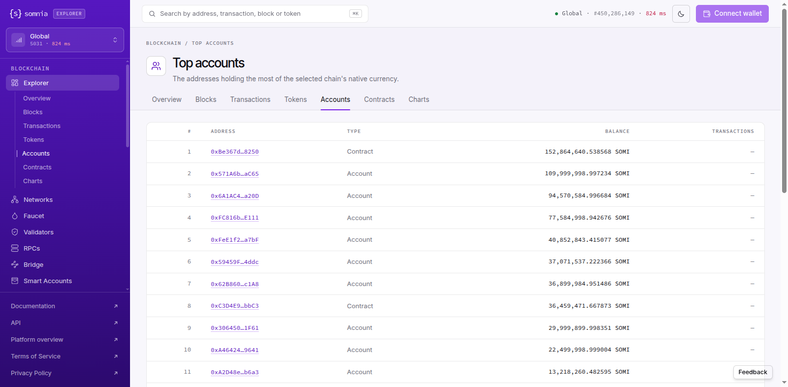

# Explorer: Top accounts leaves out every account whose SOMI arrived only through internal transfers. That is 18 accounts with 149.7M SOMI, including a 40M SOMI account that should rank #6 and 17 vesting contracts. The Etherscan `ethsupply` endpoint reports 837.5M SOMI, although supply is fixed at 1B.
Severity: major
Area: explorer

> **Summary.** The Top accounts page (`/top-accounts`, `GET /api/v2/addresses`) is described as "The addresses holding
> the most of the selected chain's native currency". It is sorted by balance, and every balance it shows matches
> `eth_getBalance`. But it leaves out accounts that hold more than its own #50 row (533,088 SOMI). We found **18**
> such accounts among Blockscout's top 50 for the same chain, holding **149,665,898 SOMI** between them. None of them
> appears in the first 150 rows. The largest is `0x7143d400…2195025`, an externally owned account with exactly
> **40,000,000 SOMI**, which should be #6. The other 17 are contracts the explorer itself names `VestingSchedule8`,
> `VestingSchedule12` and so on, with 3.16M to 9.31M SOMI each.
>
> All 18 have one thing in common: no top-level transaction has them as sender or recipient. Their SOMI arrived
> through internal calls, either from a Safe `execTransaction` or as a create plus a value call from a factory.
> The explorer has those internal transfers. Its own `/api/v2/transactions/<hash>/internal-transactions` lists the
> 39,999,999 SOMI call to `0x7143d400…` and the `create` of `VestingSchedule8` followed by a 9,289,166 SOMI call. Each
> account's own page also shows the right balance ("40,000,000 SOMI"). So the rich list appears to be built only
> from addresses seen in top-level transactions.
>
> The Etherscan-compatible supply endpoint is short by a similar amount. `GET /api?module=stats&action=ethsupply`
> returns **837,505,966 SOMI**. The docs say SOMI has "a fixed supply of 1,000,000,000 tokens". The 162.5M gap is
> 16% of supply. It is close to the 149.7M held by the 18 missing accounts. explorer.somnia.network (Blockscout)
> lists all 18 in its top 50.

> **Checked 2026-10-28 at 10:15, 10:21–10:23 and 10:43–10:44 UTC, Somnia mainnet (Global, chain 5031)**, by script against
> `eth_getBalance` at the head block, plus the rendered page, logged out. Same 18 accounts each time. Evidence:
> `evidence/52/top_accounts_2026-10-28T1022Z.txt`, `evidence/52/top_accounts_2026-10-28T1043Z.txt`,
> `evidence/52/ui_top_accounts_2026-10-28T1023Z.png`.



## Why it matters
A rich list is how people judge supply concentration and find the treasury, vesting and exchange wallets. On this
page the vesting contracts are missing (about 110M SOMI between them), and so is a 40M SOMI wallet. Every rank from #6
down is wrong, and the page gives no sign that anything is missing. The `ethsupply` figure is the one supply
trackers and wallets read through the Etherscan API, and it understates SOMI by 162.5M (16%). The page's
TRANSACTIONS column is "—" on every row (`transactions_count: null`), so the list cannot be used to tell busy wallets
from idle ones either.

## Steps to reproduce
`python3 evidence/52/top_accounts_check.py` (read-only). It reads 3 pages of `/api/v2/addresses` from the new explorer
and Blockscout's first page. It reads `eth_getBalance` at the head for Blockscout's 50 accounts and lists each one that
holds more than the new explorer's #50 but is missing from its 150 rows. Then it prints the new explorer's own address
record for the first three, how Blockscout says they were funded, and both explorers' `ethsupply`.

By hand:
1. Open https://new.explorer.somnia.network/top-accounts. #5 is `0xFeE1f2…a7bF` with 40,852,843 SOMI and #6 is
   `0x59459F…4ddc` with 37,071,537 SOMI.
2. Open https://new.explorer.somnia.network/address/0x7143d400Fa22f0899755acc11dFC2654c2195025. It shows
   "Balance 40,000,000 SOMI", "Transactions sent 0" and "No transactions". The RPC agrees:
   ```sh
   curl -s -H 'content-type: application/json' https://api.infra.mainnet.somnia.network/ \
     -d '{"jsonrpc":"2.0","id":1,"method":"eth_getBalance","params":["0x7143d400Fa22f0899755acc11dFC2654c2195025","latest"]}'
   # 0x2116545850052128000000 = 40,000,000 SOMI
   ```
3. Look for it in the list. It is not on page 1, and the list is sorted by balance, so it is not on any later page either:
   ```sh
   curl -s https://new.explorer.somnia.network/api/v2/addresses | jq '[.items[].hash] | index("0x7143d400Fa22f0899755acc11dFC2654c2195025")'
   # null
   curl -s https://explorer.somnia.network/api/v2/addresses | jq '[.items[].hash] | index("0x7143d400Fa22f0899755acc11dFC2654c2195025")'
   # 5   (rank #6)
   ```
4. See how it was funded, on the new explorer itself:
   ```sh
   curl -s https://new.explorer.somnia.network/api/v2/transactions/0xfa6c0b71ec55e68a5b71eb1e3b89b23b5c284434013aa19ae6765ede570913ed/internal-transactions \
     | jq '.items[] | select(.to.hash=="0x7143d400Fa22f0899755acc11dFC2654c2195025") | {type, from: .from.hash, value}'
   # {"type":"call","from":"0xBB296E1401d6e4c769Adc865198D1844d8cC5a13","value":"39999999000000000000000000"}
   ```
5. Compare the supply:
   ```sh
   curl -s 'https://new.explorer.somnia.network/api?module=stats&action=ethsupply'   # 837505966018963479784378622
   curl -s 'https://explorer.somnia.network/api?module=stats&action=ethsupply'       # 1000096754398186211729194606
   ```

## Expected
Top accounts lists every address by balance, wherever its SOMI came from. With these 18 included, `0x7143d400…` is
#6, five `VestingSchedule` contracts with about 9.3M SOMI each follow from #16, and so on. `ethsupply` is the native
supply, about 1,000,000,000 SOMI less burnt fees. If the explorer cannot compute it, it should return the 501 that its
`llms.txt` promises.

## Actual
`evidence/52/top_accounts_2026-10-28T1022Z.txt` (the 10:43 run is identical apart from the live balance of #1):

```
== 2026-10-28T10:22:17Z GET https://new.explorer.somnia.network/api/v2/addresses (3 pages)
   HTTP 200, x-api-backend: native, 150 rows; #1 152,864,640.48 SOMI, #50 533,088.00 SOMI, #150 30,119.90 SOMI
   transactions_count of rows 1-50: ['None']
== 2026-10-28T10:22:27Z RPC eth_getBalance at head 450,285,546 for Blockscout's top 50
   accounts holding more than the new explorer's #50 (533,088.00 SOMI) but absent from its first 150 rows: 18, together 149,665,898.85 SOMI
   0x7143d400Fa22f0899755acc11dFC2654c2195025     40,000,000.00 SOMI  EOA      nonce 0  -> would rank #6
   0x5ebFC083628aC3f2AB6275BC660d9AE96dB44Cf4      9,307,172.66 SOMI  contract nonce 1  -> would rank #16
   0xeFfEe0db234422820249Cb1Fad3De735A6016Fc7      9,304,578.50 SOMI  contract nonce 1  -> would rank #16
   0xf6205bB2b18F6F0607E99B9b16605546f85F9EEc      9,303,806.96 SOMI  contract nonce 1  -> would rank #16
   0x4268BBee503771dDFe1d003218a25246bbA76280      9,301,158.11 SOMI  contract nonce 1  -> would rank #16
   0xf8a5892064e25e047b46F91165942e09DC8FA899      9,289,166.37 SOMI  contract nonce 1  -> would rank #16
   0x1B3172EF87262fe07Ad988D4f7913e1af9646d55      6,011,391.45 SOMI  contract nonce 1  -> would rank #19
   … 9 more contracts with 5.29M–6.01M SOMI …
   0x1067f6A5e6e3a6016086C4B1aE0393bacE862a6B      3,275,357.86 SOMI  contract nonce 1  -> would rank #33
   0xf6105DCf05b22f36AD51426bf68c4f4670f3F5Ac      3,163,703.95 SOMI  contract nonce 1  -> would rank #33
== the new explorer's own address page for each missing account
   0x7143d400…2195025  coin_balance 40,000,000.00 SOMI  name None  creator None  creation_tx None
   0x5ebFC083…44Cf4    coin_balance 9,307,172.66 SOMI  name 'VestingSchedule8'  creator None  creation_tx None
== how they were funded (Blockscout; no top-level transaction has them as sender or recipient)
   0x7143d400…  top-level transactions: 0; first balance change +1.00 SOMI at block 415,928,474 (2026-09-18) in tx
                0x754908c1…, a call from 0xc3e5E30F… to 0xBB296E14… (method execTransaction)
   0x5ebFC083…  top-level transactions: 0; first balance change +9,289,166.00 SOMI at block 86,948,700 (2025-08-31) in tx
                0x8e9a4bf9…, a call from 0x772d5FeA… to 0x761d0bd3… (method execTransaction)
== Etherscan-style native supply
   https://new.explorer.somnia.network/api?module=stats&action=ethsupply -> 837,505,966.02 SOMI
   https://explorer.somnia.network/api?module=stats&action=ethsupply -> 1,000,096,754.40 SOMI
   docs (new.docs.somnia.network/concepts/tokenomics/overview.md): 'with a fixed supply of 1,000,000,000 tokens'
```

(The "would rank" figures count only the accounts the page already shows. With the other missing accounts included,
the vesting contracts rank lower still.)

## Evidence
- `evidence/52/top_accounts_2026-10-28T1022Z.txt`, `evidence/52/top_accounts_2026-10-28T1043Z.txt`: two runs of the script.
- `evidence/52/earlier_check_2026-10-28T1015Z.txt`: the first comparison (10:15 UTC). Both explorers' top 50 with RPC
  balances; it lists 17 of the 18, because the 18th was just below Blockscout's page 1 at that time.
- `evidence/52/missing_contract_names_2026-10-28T1038Z.txt`: the name the new explorer gives each of the 17 missing
  contracts (`VestingSchedule0` … `VestingSchedule22`) and their balances, 109,665,898.85 SOMI in total.
- `evidence/52/new_explorer_has_the_internal_transfers_2026-10-28T1023Z.txt`: the new explorer's own internal-transaction
  rows that funded `0x7143d400…` (39,999,999 SOMI) and created and funded `VestingSchedule8` (9,289,166 SOMI).
- `evidence/52/ui_top_accounts_2026-10-28T1023Z.png`, `evidence/52/ui_top_accounts_text_2026-10-28T1023Z.txt`: the page;
  TRANSACTIONS "—" on every row.
- `evidence/52/ui_address_0x7143d400_40M_2026-10-28T1023Z.png`: the 40M SOMI account's own page.
- `evidence/52/top_accounts_check.py`: the script.

## Suggested fix
Build the balance table from every address that has a native balance change, including recipients of internal
calls and creates, the internal-transaction `to` and `created_contract` fields the explorer already indexes, and genesis
allocations. Do not build it only from top-level `from`/`to`. Back-fill once from the internal transactions already
stored. Compute `ethsupply` from the same complete table, or from a chain-level figure. Until both are complete,
return the documented 501 rather than a partial total. Fill `transactions_count` on the list, or drop the column.

## Environment
- Explorer: https://new.explorer.somnia.network as served 2026-10-28 (`x-api-backend: native`)
- For comparison: https://explorer.somnia.network (Blockscout v10.2.6), same chain
- Somnia mainnet (Global), chain id 5031; RPC https://api.infra.mainnet.somnia.network/
- Python 3.14 (standard library only), curl 8.18.0, Chrome 155 on Linux (logged out, no wallet); read-only
